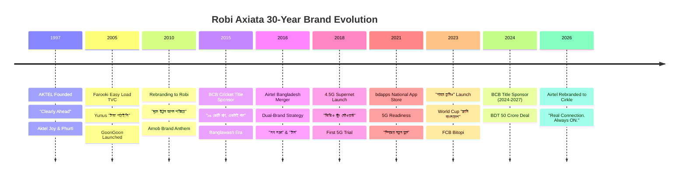

# Comprehensive Brand History & Marketing Research: Robi Axiata (AKTEL Era to 2026)

> **Document Class:** Telecom Brand History & Strategic Bengali Marketing Analysis  
> **Subject:** Evolution of Brand Identity, Advertising Slogans, Mass-Market Products, Youth Positioning, and Linguistic DNA  
> **Entity:** TM International (Bangladesh) Ltd. ➔ Axiata (Bangladesh) Ltd. ➔ Robi Axiata PLC (including Airtel Bangladesh & Cirkle)  
> **Timeline:** 1997 – 2026  
> **Target Output Path:** `e:\robi dp\marketing research\01_robi_consumer_brand_history.md`

---

## Executive Summary & Strategic Brand Narrative

Over three decades (1997–2026), Robi Axiata has undergone one of the most sophisticated brand transformations in South Asian telecommunications:
1. **The Pioneer Era (1997–2009 / AKTEL):** Positioned around superior network engineering, technical clarity, and honest voice transmission under the banner of **"Clearly Ahead"** (*এক ধাপ এগিয়ে*).
2. **The Renaissance & Rebranding (2010–2017 / Robi):** Rebranded on March 28, 2010, shedding foreign-sounding acronyms to adopt **"রবি" (Robi - The Sun)**, rooted in Bengali literary ethos and self-empowerment through the historic tagline **"জ্বলে উঠুন আপন শক্তিতে"** (*Jwole Uthun Apon Shoktite*).
3. **The Dual-Brand Consolidation (2016–2026 / Robi + Airtel):** Following Bangladesh's first telecom merger in 2016, Robi maintained a two-pronged strategy: Robi as the national empowerment engine and **Airtel** as the irreverent, emotional youth sanctuary (*"সব সম্ভব"*, *"বন্ধুর টান"*).
4. **The Modern Era (2023–2026 / Parbe Tumio & Cirkle):** Robi shifted to grassroots resilience with **"পারবে তুমিও"** (*Parbe Tumio*), re-secured the Bangladesh National Cricket Team sponsorship (2024–2027), and in August 2026 evolved Airtel into **Cirkle** (*"Real Connection. Always ON."*), tailored for an AI-native Gen-Z generation.

---

## 1. Corporate Brand Slogans & Taglines (Bengali & English)

### 1.1 The AKTEL Era (1997 – March 2010)
*Joint venture between Telekom Malaysia (TMI/Axiata) and A.K. Khan & Co., later joined by Japan's NTT DoCoMo in 2008.*

* **Official Corporate Taglines:**
  * **"Clearly Ahead"** (Bengali adapted: *এক ধাপ এগিয়ে* - Ek Dhap Egiye / ক্লিয়ারলি এহেড)
  * **"One Step Ahead"**
  * *Context:* Early cellular competition with Grameenphone and Citycell focused on coverage stability, voice clarity, and engineering superiority.
* **Vernacular Advertising Hooks & Campaign Copy:**
  * **"স্পষ্ট কথা" (Shposhto Kotha — Clear Words / Clear Talk):** Used in early transparent-billing campaigns and voice-clarity ads countering hidden charges, complex off-peak slabs, and round-up pulses.
  * **"সহজ কথা" (Shohoj Kotha — Simple Talk):** Counterpart to "স্পষ্ট কথা", emphasizing straightforward pricing without fine print.
  * **"খুলে বলো" (Khule Bolo — Speak Openly / Speak Freely):** Colloquial promotional hook used in late-2000s prepaid airtime campaigns, urging subscribers to talk without anxiety over ticking meter charges.
* **Iconic Creative Landmark:**
  * *The "Aktel Easy Load" TVC (directed by Mostofa Sarwar Farooki):* Starring Marzuk Russell as "Yunus" (*"ইউনুস... টাকা পাঠাইসি..."*), this ad revolutionized Bangladeshi telecom marketing by replacing stiff corporate presentations with raw, authentic street-level humor.

---

### 1.2 The 2010 Robi Launch: "জ্বলে উঠুন আপন শক্তিতে"
*Rebranded on March 28, 2010, under Axiata Group Berhad.*

* **Corporate Brand Tagline:**
  * **Bengali:** **"জ্বলে উঠুন আপন শক্তিতে"**
  * **English Transliteration:** *Jwole Uthun Apon Shoktite*
  * **English Translation:** *"Ignite the power within"* / *"Ignite with your own power"*
* **Cultural & Symbolic Architecture:**
  * **The Name "রবি" (Robi):** Meaning "The Sun", invoking dawn, life-giving energy, warmth, and deep cultural resonance with Nobel laureate Rabindranath Tagore.
  * **The Visual Identity:** Axiata’s geometric prism logo (rich red, warm yellow, deep blue/green), reflecting vibrancy and multi-faceted potential.
  * **The Brand Promise:** Positioned not as an aloof technology supplier, but as a catalyst helping 160 million citizens unlock their latent human potential.
* **The Brand Anthem — "রবির গান" (Robir Gaan):**
  * Composed and sung by Shayan Chowdhury Arnob (*"জ্বলে উঠুন আপন শক্তিতে... রবির আলোয় জাগো রে..."*). A benchmark in corporate sound branding blending Bengali folk sensibilities with contemporary alternative acoustic rock.

---

### 1.3 Recent Campaigns, 4.5G/5G, and Brand Evolution (2018 – 2026)

* **"পারবে তুমিও" (Parbe Tumio — You Can Too / You Can Do It Too):**
  * *Launch Window:* July 2023 – Present.
  * *Creative Agency:* FCB Bitopi; *Director:* Adnan Al Rajeev.
  * *Brand Philosophy:* Celebrates the unyielding resilience (*জেদ* - Jed, *লড়াই* - Lorai) of ordinary Bangladeshis overcoming inflation, socio-economic friction, and personal hardship.
  * *Cricket World Cup Adaption (2023):* **"জানি বাংলাদেশ, পারবে তুমিও"** (*Jani Bangladesh, Parbe Tumio* - "Bangladesh knows it, you can too").
* **Brand Clarification: "নতুন কিছু করো" (Notun Kichu Koro):**
  * *Industry Attribution:* **"নতুন কিছু করো"** (*Start Something New*) was the famous 2013 3G-era slogan of competitor **Banglalink** (succeeding *"দিন বদল"*).
  * *Brand Distinction:* While Banglalink leveraged restless, disruptive energy (*"নতুন কিছু করো"*), Robi consistently pursued deep-seated personal empowerment and dignity (*"জ্বলে উঠুন আপন শক্তিতে"* ➔ *"পারবে তুমিও"*).
* **"Believe in You" / "Ready for Tomorrow" / "Ready for the Future":**
  * Strategic positioning campaigns highlighting youth digital skills, tech sovereignty, and readiness for artificial intelligence and automation.
* **4.5G & 5G Network Taglines:**
  * **4.5G Launch (2018):**
    * **"ভিডিও স্ট্রং নেটওয়ার্ক"** (*Video Strong Network*) — Highlighting buffer-free HD streaming, mobile gaming, and dynamic spectrum sharing.
    * **"লাইফ যেখানে যেভাবে, রবি ৪.৫জি সেখানে সেভাবে"** (*Life jekhane jebhabe, Robi 4.5G shekhane shebhabe* — Wherever and however life happens, Robi 4.5G is right there).
    * **"৪.৫জি সুপারনেট"** (*4.5G Supernet*).
  * **5G Trials & Deployments (2018 First Trial, 2021+ Commercial Readiness):**
    * **"দেশের প্রথম রবি 5G নেটওয়ার্কে স্পিডের নতুন যুগে বাংলাদেশ!"** (*Desher prothom Robi 5G network-e speed-er notun yuge Bangladesh!*)
    * **"স্পিডের নতুন যুগে আমরা"** (*Speed-er notun yuge amra* — We are in a new era of speed).

---

## 2. Mass Market Tariff Packages & Feature Names

### 2.1 Historical Package Lineage & Market Clarification

| Brand Era | Package / Campaign Name | Bengali Script | Core Proposition & Target Segment |
| :--- | :--- | :--- | :--- |
| **AKTEL** | **Joy** | জয় | Partner Pack; dual-SIM paired starter pack for couples/buddies with deeply discounted inter-pair calling. |
| **AKTEL** | **Phurti** | ফুর্তি | Talktime bonus model rewarding incoming minutes from other networks. |
| **AKTEL** | **Excellence** | এক্সিলেন্স | Flagship postpaid product for corporate executives and high-ARPU urban consumers. |
| **AKTEL** | **Club Magenta** | ক্লাব ম্যাজেন্টা | Premium lifestyle and loyalty club (reflecting AKTEL's signature magenta-black corporate palette). |
| **AKTEL** | **Dosh** | দশ | Flat 10-paisa/10-second pulse package introduced during intense tariff wars. |
| **AKTEL** | **Ekshathe** | একসাথে | Community calling bundle designed for families and small business groups. |
| **Robi** | **Shorol (39)** | সরল | Simplified flat-rate plan with a designated low-cost *Priyo* (favourite) number. |
| **Robi** | **Goti (36)** | গতি | Flat-rate per-second/10-second calling plan with automated recharge-triggered data incentives. |
| **Robi** | **Nobanno (37)**| নবান্ন | Harvest/seasonal-themed tariff featuring aggressive off-peak and night calling slabs. |
| **Robi** | **Hulloor / Utshob** | হুল্লোড় / উৎসব | Community holiday calling packs rolled out around Eid and Durga Puja. |

> **Telecom Industry Truth Check on "নিশ্চিন্ত" (Nishchinto) & "বন্ধু" (Bondhu):**  
> In Bangladesh telecom taxonomy, *"নিশ্চিন্ত"* (Nishchinto - flat rate simplicity) and *"বন্ধু"* (Bondhu - 18 FnF numbers) were the legendary flagship prepaid products of market leader **Grameenphone**. Robi’s exact direct responses were **সরল (Shorol)** and **গতি (Goti)**, alongside aggressive rate-cutter cards.

---

### 2.2 Mass Market Recharge & Packaging Themes

* **"মহোৎসব" (Mohotshob — Mega Recharge Festivals):**
  * High-energy promotional campaigns (e.g., *রিচার্জ মহোৎসব* - Recharge Mohotshob, *সিম মেলা* - SIM Mela, *কোটিপতি উৎসব* - Kotipoti Utshob). Leveraged gamified recharge brackets rewarding top daily rechargers with motorcycles, gold coins, smartphones, and bonus airtime.
* **"পয়সা উসুল" (Poisha Usul — Value for Money):**
  * Ubiquitous telecom vernacular used across Robi's rate-cutters and minute bundles. Emphasized that every single poisha spent returned maximum utility (e.g., *১ পয়সা/সেকেন্ড অফার*, micro-validity minute packs for day laborers and rickshaw pullers).
* **"সপ্তাহজুড়ে" (Soptahjure — All Week Long):**
  * Robi's standardized 7-day voice, data, and social media combo packs designed to align with the weekly cash flows of rural bazaar merchants and working-class consumers.
* **"ঝটপট ব্যালেন্স" (Jhotpot Balance — Instant Balance Loan):**
  * Robi’s emergency micro-credit airtime and data advance service. Dialed via `*123*007#` or quick code `*8#`, auto-deducted upon the next flexiload recharge.

---

### 2.3 USSD Menus, Codes, and Signature Services

* **"আমার অফার" (Amar Offer) — `*888#`:**
  * Robi's signature, industry-defining personalized offer engine. Powered by internal algorithmic customer analytics, `*888#` served dynamic 1-to-1 discounted bundles tailored to each subscriber's historical usage pattern. Tagline: *"আমার জন্য সেরা অফার, ডায়াল \*৮৮৮#"*.
* **"গুনগুন" (GoonGoon) — `*8466#` / IVR `28466`:**
  * Robi’s legendary Caller Ring Back Tone (CRBT) platform originating from the AKTEL era. Elevated into a cultural phenomenon where callers listened to popular Bengali tunes, folk songs, or comedy skits instead of standard dial tones. Later introduced *Name Tune* (*নিজের নামের গুনগুন*).
* **"ইচ্ছাটুন" (Ichchatun):**
  * Personalized status tuner allowing subscribers to set custom voice messages or moods for specific callers.
* **"ব্যালেন্স ট্রান্সফার" (Balance Transfer) — `*140*1#` / `*123*4#`:**
  * Peer-to-peer balance sharing service, critically important in non-urban communities for remote family support.
* **Core Account USSD Dial Codes:**
  * Main Balance Check: `*222#`
  * Emergency Loan (*ঝটপট ব্যালেন্স*): `*123*007#` or `*8#`
  * Internet (MB) Balance: `*8444*88#` (legacy) or `*3#`
  * Robi Master Self-Care Portal: `*123#` / `*140#`
  * Smartphone Digital Hub: **My Robi App**

---

## 3. Youth & Segment Branding (Airtel Bangladesh under Robi & Beyond)

### 3.1 The Airtel Bangladesh Integration & Cultural Heritage

* **Lineage & Acquisition History:**
  * **Warid Telecom (2007–2010):** Launched by the Abu Dhabi Group with the emotional, artistic campaign **"সালাম বাংলাদেশ"** (*Salam Bangladesh*) and Habib Wahid's smash hit **"ভালোবাসা কথা বলে"** (*Bhalobasha Kotha Bole*).
  * **Bharti Airtel Bangladesh (2010–2016):** Acquired Warid in 2010. Taglines: *"Enriching lives"*, *"দিল খুলে কথা বলুন"* (*Dil Khule Kotha Bolun*), and *"বলো খোলাখুলি"* (*Bolo Kholakhuli*).
  * **The Landmark Merger (November 2016):** Robi Axiata and Airtel Bangladesh completed Bangladesh's first telecom merger. Robi retained the Airtel brand as an independent, youth-centric operational brand under a dual-brand strategy.

* **Airtel's Youth Slogans & Cultural Hooks under Robi:**
  * **"ফ্রেন্ডস ফার্স্ট" (Friends First):** Anchored on the philosophy that among students and teenagers, friendship takes precedence over all worldly obligations.
  * **"সব সম্ভব" / "বন্ধু থাকলে সব সম্ভব" (Shob Shombhob — Everything is Possible with Friends):** Celebrated youth camaraderie, mutual bail-outs, group study sessions, and midnight bike rides.
  * **"টান" (Taan — The Emotional Pull / The Bond):** Used powerfully across campaigns (*"বন্ধুর টান"*, *"দিলের টান"*, *"নাড়ির টান"*) to describe the irresistible desire to stay connected with true friends.
  * **"বন্ধুত্ব" (Bondhutwo — Friendship):** Positioned Airtel as *"The #1 Network of Friends"*, famous for unlimited FnF, 1-second pulse, and ultra-cheap night data packs.

* **2026 Milestone: Rebranding Airtel to "Cirkle":**
  * *Event:* In August 2026, Robi officially retired the 16-year-old Airtel brand name, completing its evolutionary cycle.
  * *New Brand Name:* **Cirkle**
  * *Official Tagline:* **"Real Connection. Always ON."**
  * *Audience & Strategy:* Hyper-targeted toward Gen-Z and Gen-Alpha, focusing on AI integrations, creator economy tools, competitive mobile gaming (esports), and subculture communities, while fully preserving subscribers' `016` numbering prefix and balance assets.

---

### 3.2 Music, Cricket, and Youth Strategic Properties

* **Cricket Sponsorship (The National Emotional Anchor):**
  * **The Golden Era (2015–2017):** Robi served as the title sponsor of the Bangladesh National Cricket Team during its historic ODI series victories against Pakistan, India, and South Africa (the legendary "Banglawash" era).
  * **The Historic Return (February 2024 – July 2027):** Robi signed a 3.5-year title sponsorship deal with the Bangladesh Cricket Board (BCB) for BDT 50 Crore.
  * **Signature Cricket Anthems & Campaigns:**
    * **"জানি বাংলাদেশ, পারবে তুমিও"** (2023–2024 World Cup & bilateral series anthem)
    * **"১৬ কোটি প্রাণ, একটাই গান"** (16 Koti Pran, Ektai Gaan — Bappa Mazumder & ensemble)
    * **"জ্বলে ওঠো বাংলাদেশ"** (*Jwole Otho Bangladesh* — Ignite, Bangladesh)
    * **"রবির সাথে বাংলাদেশ"** (*Robi-r Shathe Bangladesh*)
    * Stadium crowd anthem: *"চার-ছক্কা হই হই, বল গড়িয়ে গেলো কই"*

* **Music & Digital Youth Properties:**
  * **bdapps (The National App Store):** Originally founded by Robi as a telco-API monetization gateway, declared by the ICT Division of Bangladesh in March 2021 as the **National App Store of Bangladesh**. Empowers over 50,000 youth developers to build and monetize apps via direct carrier billing.
  * **Robi Datathon:** Bangladesh's largest and most prestigious nationwide youth hackathon focused on Big Data, Machine Learning, and Artificial Intelligence.
  * **Robi-Yonder Music:** Pioneer music streaming collaboration in Bangladesh offering ad-free legal music streaming.
  * **Airtel Buzz / Airtel Yolo:** University campus concert platforms, rock band competitions, and streetwear culture hubs.

---

## 4. Key Tone of Voice & Linguistic Patterns

### 4.1 The Cultural & Emotional DNA of Robi's Copywriting

In the Bangladeshi telecom landscape, each major brand carved out a distinct linguistic territory:
* *Grameenphone (GP):* Institutional, dignified, sweeping, and paternal. Rooted in national infrastructure, rural empowerment, and poetic pride (*"চলো বহুদূর"*, *"কাছে থাকুন"*).
* *Banglalink:* Defiant, energetic, urban, streetwise, and disruptive. Rooted in youthful rebellion and restlessness (*"দিন বদল"*, *"নতুন কিছু করো"*).
* *Robi Axiata:* **Introspective, deeply emotional, self-reliant, gritty, and culturally poetic.**
  * Robi never portrays the telecom company as the hero. Instead, the consumer is the undisputed hero, and Robi is merely the sacred spark that ignites their inner fire.
  * **The Pronoun Shift (*আপনি* to *তুমি*):** Robi began in 2010 with the formal, respectful Bengali second-person pronoun **"আপনি"** (*"জ্বলে উঠুন আপন শক্তিতে"*), reflecting corporate deference. By 2023, Robi pivoted to the intimate, brotherly, empowering pronoun **"তুমি"** (*"পারবে তুমিও"*, *"তোমার ভেতরের বিশ্বাস"*), building lateral trust and kinship with the youth.

---

### 4.2 Signature Bengali Verbs, Idioms, and Metaphors in Robi Copy

#### Distinctive Bengali Verbs
* **জ্বলে ওঠা (Jwole Otha — To ignite / To blaze):** The supreme brand verb. Represents sudden, brilliant awakening of latent strength.
* **জাগা / জাগিয়ে তোলা (Jaga / Jagiye Tola — To awaken / To rouse):** Stirring the dormant genius inside ordinary people.
* **পারা (Para — Can / To be capable):** Featured in the command form *"পারবে তুমিও"* (You can do it too). Replaces passive hope with resolute agency.
* **ঘুরে দাঁড়ানো (Ghure Daran — To turn around / To rebound):** Reflects the archetypal Bangladeshi narrative of surviving floods, poverty, and crises through sheer willpower.
* **এগিয়ে যাওয়া (Egiye Jawa — To surge forward):** Unwavering forward momentum against all headwinds.
* **ছড়িয়ে পড়া (Chhoriye Pora — To radiate / To disperse widely):** Symbolic of sunlight diffusing across 64 districts.
* **জুড়ে থাকা (Jure Thaka — To remain intertwined / Bonded):** Unconditional connection regardless of distance.

#### Core Metaphors & Conceptual Vocabulary
* **আপন শক্তি (Apon Shokti — Innate power / Inner fire):** The philosophical foundation of the brand since 2010.
* **অদম্য জেদ (Odommo Jed — Untamable tenacity / Invincible grit):** Framing stubborn refusal to give up as Bangladesh's greatest national asset.
* **প্রাণের বহ্নিশিখা (Praner Bohnishikha — The flame of the soul):** Sun/fire imagery tied to the "Robi" solar brand identity.
* **আলোর দিশা (Alor Disha — The guiding beacon of light):** Guiding people out of darkness and uncertainty through knowledge and connectivity.
* **মাটির টান (Matir Taan — The pull of the soil):** Cultural authenticity connecting high-tech digital services to village roots.
* **লড়াইয়ের ময়দান (Lorai-er Moydan — The battleground of life):** Honoring the day-to-day economic struggles of ordinary families.
* **বাধা ভাঙার গান (Badha Bhangar Gaan — The song of breaking barriers):** Framing connectivity as a tool to shatter class, geographic, and generational divides.

---

## 5. Chronological Brand Architecture Matrix (1997 – 2026)

---

## 6. Takeaways for Marketing & Presentation Copywriting

1. **Keep Headlines Benefit-Driven and Vernacular:** Avoid technical telecom jargon (e.g., avoid writing "USSD dynamically priced VAS packages"; write *"আমার অফার: ১-টু-১ পারসোনালাইজড অফার"* or *"ঝটপট ব্যালেন্স: বিপদের মুহূর্তের ভরসা"*).
2. **Honor the Hero Inversion:** In Robi's brand cosmos, the network is never the hero; the user's *অদম্য জেদ* (unyielding tenacity) is the hero. The network is merely the conduit (*আপন শক্তিকে বাস্তবে রূপ দেওয়ার হাতিয়ার*).
3. **Preserve Linguistic Authenticity:** Balance the poetic, uplifting register of the main brand (*জ্বলে উঠুন, পারবে তুমিও, আলোর দিশা*) with the relatable colloquial ease of the youth properties (*বন্ধুর টান, সব সম্ভব, রিয়েল কানেকশন*).

*(This markdown report is ready to be stored directly into `e:\robi dp\marketing research\01_robi_consumer_brand_history.md`.)*