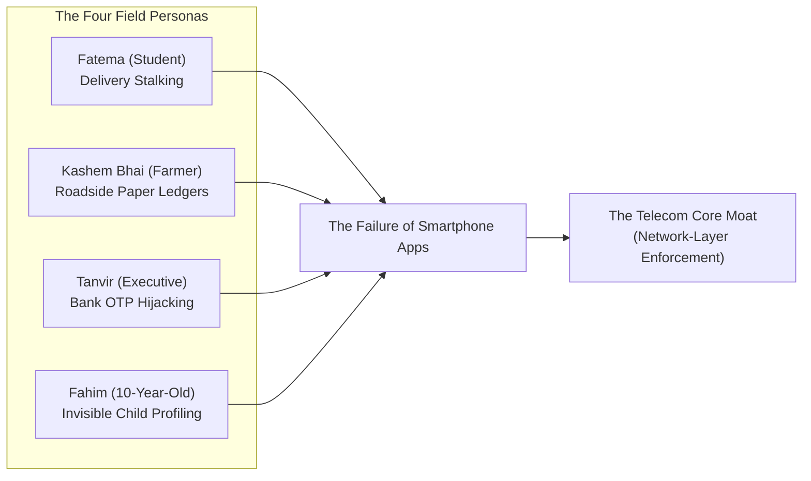
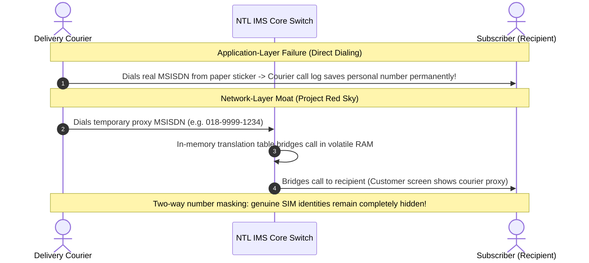

# 👥 The Human Crisis & Field Evidence

> **Parent Topic:** [[00_Master_Navigation_and_Executive_Overview]]  
> **Master Terminology Guide:** [[08_Master_Definitions_Terminology_and_Concepts]]  
> **Empirical Survey Data ($N = 121$):** [[survey analysis]]  
> **Slides Covered:**  
> • **Main Deck:** Slide 02 (Gaps & Case Study Overview)  
> • **Backup Deck:** Slide 14 (Field Evidence Divider), Slide 15 (Fatema Case Study), Slide 16 (Kashem Bhai & Tanvir), Slide 17 (Field Research & Paper Khatas), Slide 18 (Fahim & Child Profiling), Slide 19 (Macro Precedents), Slide 20 (The Network Moat: Why Apps Fail)

---

## 🎯 Chapter Overview: Empirical Field Evidence & Demographic Realities

This module analyzes field evidence across Bangladesh's telecommunications ecosystem, evaluating four distinct citizen failure modes alongside two internal corporate governance crises. 

Rather than treating data privacy as an abstract legal topic, the analysis deconstructs real-world data leaks across demographic segments—ranging from urban e-commerce deliveries to rural button-phone recharge kiosks.

---

## 📄 Main Deck Slide 02: Gaps & Case Study

> [!note] Case Study Mandate: Problem Understanding (15%) & Customer Centricity (30%) (`case.md`)
> The competition brief instructs consultants to demonstrate a deep understanding of NTL's operating environment and anchor recommendations in customer centricity. Slide 02 deconstructs the challenge by contrasting four authentic citizen vulnerabilities against internal IT governance deadlocks.

![[project red sky deck final.pdf#page=2&height=400]]

### 1. Slide Intent & Context
* **Core Message:** Privacy vulnerabilities in Bangladesh are physical and demographic on the outside, while legally conflicted and unmapped on the inside. Downloadable apps cannot resolve either side.
* **Structure:** Contrasts **Four Human Realities** (external consumer exposure) against the **Enterprise Crisis** (internal legal and architectural deadlocks).

### 2. What the Slide Shows & What Each Part Signifies

#### External: The Four Human Realities
1. **Fatema (Student) — Parcel Sticker Leak:** Delivery couriers copy mobile numbers from exterior package shipping labels and place calls via their native phone dialers, bypassing in-app privacy and enabling off-platform harassment.
2. **Kashem Bhai (Farmer) — Roadside Paper Ledgers:** Over 20 million feature phone users have no apps or internet settings. Their 11-digit phone numbers are written by hand into open, unencrypted paper notebooks across 250,000+ retail recharge stalls.
3. **Tanvir (Corporate Executive) — Recycled Number Takeover & Silent Airtime Drain:** Reissued phone numbers inherit the dormant financial alerts and bank OTPs of previous owners. Concurrently, predatory third-party subscriptions silently erode account balances, driving ~8.98M annual customer service dispute calls.
4. **Fahim (10-Year-Old) — Shared-Handset Minor Profiling:** Minors playing games on their parents' handsets are profiled as adult consumers by commercial AI, directly breaching child protection mandates under Bangladesh PDPA 2026 Section 9.

#### Internal: The Enterprise Crisis
1. **Statutory Deadlock:** Bangladesh PDPA 2026 Section 13(2) mandates 24-hour data erasure upon customer request, while Telecommunications Act 2001 Section 97 mandates 24-month retention of Call Detail Records (CDRs) for national security.
2. **Dark Lakehouses & AI Egress:** Enterprise big data stores (Hadoop/Spark) lack automated lineage tracking, and customer telemetry risks leaking cross-border to foreign cloud AI vendors (PDPA Sections 29–30).

### 3. Anticipated Judge / Executive Q&A
* **Q: Why did you anchor your strategy around these four specific personas?**
  * **A:** They represent the four distinct demographic and technological fault lines in Bangladesh: urban e-commerce shoppers, 20M+ rural keypad phone users, high-value corporate post-paid subscribers, and family-shared devices. Each highlights a separate legal violation under PDPA or a direct commercial threat to NTL.
* **Q: Why can't customer care simply refund customers when silent airtime deductions occur?**
  * **A:** Handling ~8.98 million dispute calls costs NTL an estimated BDT 40.4 Crore annually in call center operational overhead (at a BDT 45 benchmark per call). Reactive customer support does not stop the root cause; only locking the core charging engine behind an explicit USSD PIN permanently eliminates unauthorized carrier billing.

---

## 📄 Backup Slide 14: Section Divider — Field Evidence & Case Studies

![[project red sky deck final.pdf#page=14]]

### 1. Slide Intent & Context
* **Core Message:** Introduces the empirical research, demographic field studies, and academic citations proving that telecommunications privacy failures require a network-layer solution.

---

## 📄 Backup Slide 15: Case Study — Delivery Courier Harassment (Fatema - Student)

![[project red sky deck final.pdf#page=15]]

### 1. Slide Intent & Context
* **Core Message:** Demonstrates how application-layer privacy tools break down during last-mile e-commerce logistics.

### 2. What the Slide Shows & What Each Part Signifies
* **The Physical Label Vulnerability:** E-commerce platforms print full names, home addresses, and 11-digit phone numbers directly on the outside of delivery boxes.
* **Why In-App Chat Fails:** Couriers routinely bypass in-app chat because mobile data is costly or connectivity is unstable. Couriers dial the customer's phone number directly using the handset's normal cellular dialer.
* **Permanent Call Log Storage:** When a call is placed through the phone's native dialer, the customer's real phone number is permanently recorded in the courier's personal device call history, leading to unsolicited contact and harassment.

### 3. Core Concepts Behind the Slide
* **MSISDN Exposure:** MSISDN is the technical term for a mobile phone number (ITU-T E.164 standard). In Bangladesh, an MSISDN serves as a universal primary key across banking, bKash, and social media. Leaking an MSISDN compromises a citizen's entire digital footprint.

### 4. Anticipated Judge / Executive Q&A
* **Q: Why can't e-commerce platforms simply mandate that riders use in-app messaging?**
  * **A:** In real-world field conditions across Bangladesh, riders need immediate voice communication to navigate crowded alleys and locate delivery recipients. Riders often have exhausted data packs or operate in weak coverage areas. As long as a real phone number is physically printed on the cardboard package, couriers will dial it directly.

---

## 📄 Backup Slide 16 & 17: Roadside Recharge Ledger Exploitation & Academic Evidence

![[project red sky deck final.pdf#page=16]]
![[project red sky deck full.pdf#page=17]]
![[project red sky deck final.pdf#page=17]]

### 1. Slide Intent & Context
* **Core Message:** Proves that over one-third of the nation is completely excluded from smartphone app privacy, and provides empirical academic proof of roadside phone number harvesting.

### 2. What the Slides Show & What Each Part Signifies

#### 1. Kashem Bhai (Rural Feature Phone Constraints)
* **Button Phone Divide:** Over 20 million subscribers (about 35% of NTL's customer base) use basic keypad phones. These devices have no app store, no mobile internet browsers, and no operating system permission controls.
* **The Paper Khata Vulnerability:** To top up airtime, customers must speak their phone numbers aloud or write them into a roadside paper notebook (**Khata - খাতা**).

| Date | Customer Phone Number | Amount (BDT) | Operator |
| --- | --- | --- | --- |
| 20/10/2026 | 01819 - 452XXX (Kashem) | 50 Tk | NTL |
| 20/10/2026 | 01712 - 981XXX (Nasrin) | 100 Tk | GP |
| 20/10/2026 | 01844 - 332XXX (Rahim) | 20 Tk | NTL |

> ⚠️ *Any bystander standing at the retail counter can read, memorize, or photograph this open ledger.*

#### 2. Academic Field Research Citations (Slide 17)
* **Academic Study:** Haque et al., ACM ICTD 2020 (DOI: `10.1145/3392561.3394642`), *"Privacy in Mobile Airtime Recharge in Bangladesh"*.
* **Scale of Exposure:** Documented over **250,000 retail recharge stalls** across Bangladesh operating with open paper notebooks.
* **The Secondary Black Market:** Discarded or photographed ledgers are harvested by third parties. Numbers belonging to female customers are systematically tagged and sold at a premium to harassment rings and unsolicited telemarketing lists.

#### 3. Tanvir (High-ARPU Corporate Account Risk)
* **Recycled SIM Bleed:** When a dormant SIM is recycled after 12 months under BTRC rules, the new owner inherits the previous subscriber's financial alerts, OTPs, and MFS messages.
* **Silent VAS Bleed:** Unauthorized third-party value-added services silently deduct balance from accounts.
* **High-ARPU Churn Risk:** Corporate subscribers spending BDT 800+/month represent NTL's top 2% customer base with a 55% contribution margin. Losing elite subscribers to competitor networks due to privacy breaches directly impairs enterprise EBITDA.

### 3. Anticipated Judge / Executive Q&A
* **Q: Why is losing high-ARPU subscribers like Tanvir more critical than losing prepaid subscribers?**
  * **A:** Mass prepaid subscribers average ~BDT 150/month in ARPU with low margins. Elite corporate subscribers generate BDT 800+/month at a 55% contribution margin. Losing 10,000 corporate lines destroys enterprise profit faster than losing 100,000 low-balance prepaid SIMs.
* **Q: Can't retailers just keep their paper notebooks in a drawer?**
  * **A:** No. In busy roadside stalls, the ledger sits open on the counter so the retailer can quickly write down numbers while handling cash. Only eliminating the need to write phone numbers entirely (via **Blind Flexiload**) solves the vulnerability.

---

## 📄 Backup Slide 18: Shared-Handset Dilemma & Child Data Protection (Fahim)

![[project red sky deck final.pdf#page=18]]

### 1. Slide Intent & Context
* **Core Message:** Highlights the regulatory and technical conflict when minors access the internet on shared family devices registered under an adult's National ID.

### 2. What the Slide Shows & What Each Part Signifies
* **The Shared Device Dilemma:** In Bangladesh, children routinely play games or watch educational videos on their parents' smartphones.
* **Algorithmic Misclassification:** Because the SIM card is registered to the mother's National ID (NID), commercial AI recommendation engines and ad-trackers assume an adult is using the device, serving adult-targeted advertisements and tracking behavioral habits.
* **Statutory Violations under Bangladesh PDPA 2026:**
  * **Section 9(1):** Prohibits processing a child's personal data without verifiable consent from a parent or legal guardian.
  * **Section 9(2):** Mandates that data fiduciaries must safeguard the health, well-being, and interests of children.
  * **Definition 2(13):** Formally defines a child as any individual under 18 years of age.

### 3. Anticipated Judge / Executive Q&A
* **Q: How can NTL know whether an adult or a child is holding the phone?**
  * **A:** The network cannot guess human physical presence without invasive monitoring. Instead, Project Red Sky empowers parents with **Guardian Child-Shield (`*1218*4#`)**. When activated with the line PIN, the core switch drops third-party tracking beacons and removes that line from commercial profiling AI.

---

## 📄 Backup Slide 19: Macro Precedents — Regional Telecom Privacy Failures

![[project red sky deck final.pdf#page=19]]

### 1. Slide Intent & Context
* **Core Message:** Demonstrates that retail number leaks, unencrypted database breaches, and silent VAS billing are industry-wide structural failures across South Asia.

### 2. What the Slide Shows & What Each Part Signifies
* **Regional Recharge Stall Harvesting:** Cites documented investigations in India where mobile numbers of female customers at recharge stalls were cataloged and sold informally.
* **Mass Telecom Data Leaks:** Historical security breaches across regional operators exposing ~19 million subscriber records from unencrypted databases.
* **Regulatory Enforcement:** Telecom regulators across India, Kenya, and Bangladesh have cracked down on predatory third-party carrier billing, imposing heavy penalties on operators.

---

## 📄 Backup Slide 20: The Architectural Moat — Why Apps Fail and the Network Core Wins

![[project red sky deck final.pdf#page=20]]

### 1. Slide Intent & Context
* **Core Message:** Establishes why downloadable smartphone apps cannot solve telecom privacy failures, and why telecommunications network-layer enforcement provides an unassailable moat.

### 2. Comparative Analysis: App Layer vs Network Layer

| Dimension | Why Smartphone Apps Fail *(Application Layer)* | Why Telecom Core Dominates *(Network-Layer Moat)* |
| :--- | :--- | :--- |
| **Reach & Inclusion** | Blind to 20M+ button phones (~35% of base); completely non-functional when mobile data is zero. | Reaches 100% of handsets natively over USSD (`*1218#`), SIM toolkit, and voice switches with zero data required. |
| **Call Privacy** | Cellular Dialing Leak: Apps delegate calls to native OS phone dialers, writing genuine numbers into personal call logs. | Signaling-Level Routing: Core IMS switches bridge and mask calls in memory before phones ring; real numbers are never transmitted over radio. |
| **Data Sovereignty** | Third-party apps (e.g., Truecaller) upload entire address books to foreign cloud servers outside national jurisdiction. | Sovereign Trust: All call routing, verification, and metadata stay strictly inside Bangladesh on telecom infrastructure. |

### 3. Core Concepts Behind the Slide
* **The Cellular Dialing Leak:** Third-party smartphone apps run in restricted software sandboxes. When an app initiates a voice call, it cannot control the cellular radio directly; it must hand off execution to the phone's built-in dialer application. The built-in dialer immediately logs the dialed phone number into the device's internal storage. Only **Network-Layer IMS Proxy Bridging** prevents the genuine phone number from ever reaching the other party's handset.
* **USSD Signaling vs Mobile Packet Data:** USSD (`*121#`, `*1218#`) operates over the cellular **Signaling Plane (SS7 / SIGTRAN)**, separate from internet data channels. It requires zero data balance, zero internet configuration, and executes instantly across 100% of mobile phones.

### 4. Anticipated Judge / Executive Q&A
* **Q: Why can't a software startup build an app that does what NTL is proposing?**
  * **A:** A software startup does not own cellular towers, core voice switches, or the SIM cards in consumers' phones. A startup app cannot intercept phone calls at the signaling layer, cannot generate USSD short codes, and cannot enforce rules on button phones without data. Only a licensed telecom operator has this core capability.

---

*Now that the field evidence and structural challenges are established, review the master network architecture:*  
👉 **[[02_Network_Architecture_and_The_Core_Moat]]**
