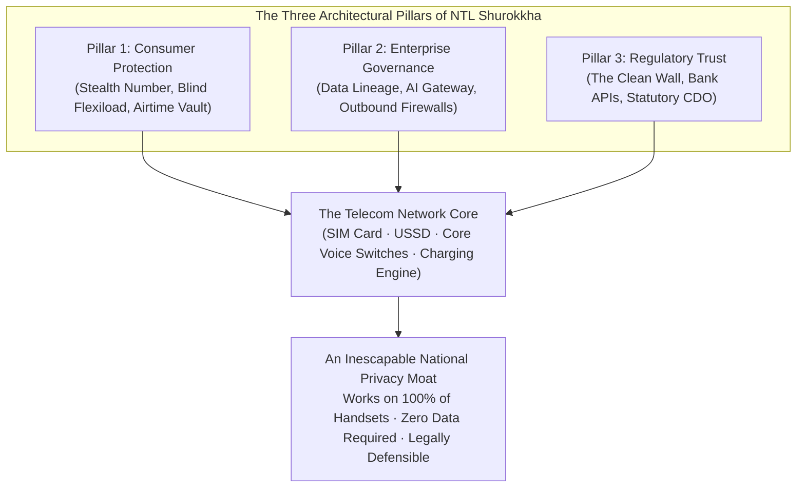

# 🏗️ Network Architecture & The Core Moat

> **Parent Topic:** [[00_Master_Navigation_and_Executive_Overview]]  
> **Master Terminology Guide:** [[08_Master_Definitions_Terminology_and_Concepts]]  
> **Slides Covered:**  
> • **Main Deck:** Slide 01 (Title & Mission), Slide 03 (Architectural Blueprint), Slide 12 (Concluding Vision & Network-Layer Utility)

---

## 🎯 Chapter Overview: Transforming Privacy into a Carrier-Grade Utility

This module presents the architectural strategy advised to New Telecom Ltd (NTL) executive leadership. 

Between the enactment of the **Personal Data Protection Act (PDPA) 2026**, the proliferation of **third-party AI scrapers**, and widespread **retail phone number leaks**, telecom operators can no longer function merely as passive "dumb pipes" that transmit data while absorbing full legal and commercial liabilities.

Project Red Sky establishes a strategic pivot: **transitioning privacy from an optional downloadable smartphone app feature into an inescapable, carrier-grade network utility.**

---

## 📄 Main Deck Slide 01: Cover Slide & Strategic Mission

![[project red sky deck final.pdf#page=1]]

### 1. Slide Intent & Context
* **Core Message:** Privacy is not an optional app feature—it must be built directly into the telecommunications core, covering 100% of subscribers across Bangladesh.
* **Target Audience:** NTL Board of Directors, Managing Director, CEO, CTO, CCO, and Chief Legal Officer.
* **Key Metric:** Delivers sovereign privacy across **58.6 million subscribers** while generating **+BDT 35.5 Crore in net accretive annual EBITDA**.

### 2. What the Slide Signifies
* **"Built into the Core, Enforced Across Every App and Handset":** Signifies that security enforcement happens at the cellular switch and SIM card level, meaning it cannot be uninstalled by users, disabled by malware, or disrupted when mobile internet data is exhausted.
* **Advising New Telecom Ltd (NTL):** Grounds the recommendations in NTL's specific market position as Bangladesh's forward-looking digital operator.

### 3. Anticipated Judge / Executive Q&A
* **Q: Why should a telecom operator invest in privacy when our primary business is selling voice minutes and data packs?**
  * **A:** Voice and raw data bandwidth have become commoditized, low-margin products facing intense price competition. Trust and verified identity are high-margin services. By securing the network core, NTL defends its top 2% high-ARPU post-paid subscribers (BDT 800+/month) and unlocks high-margin B2B revenue by selling verified SIM-swap fraud checks to commercial banks for +BDT 11.4 Cr/year.
* **Q: Why brand this architecture as "NTL Shurokkha"?**
  * **A:** *Shurokkha* (সুরক্ষা - Protection) transforms complex telecom protocols into an intuitive, trusted consumer brand that ordinary citizens on keypad phones and smartphones can easily recognize and use via simple USSD dial codes (`*1218#`).

---

## 📄 Main Deck Slide 03: Architectural Blueprint

![[project red sky deck final.pdf#page=3]]

### 1. Slide Intent & Context
* **Core Message:** NTL organizes its defensive and commercial architecture across three interlocking pillars rather than viewing data privacy as a passive legal checklist.
* **Strategic Thesis:** *"Network-layer control can't be uninstalled, works with no data connection, and reaches every subscriber — an app can't claim any of the three."*

### 2. What the Slide Shows & What Each Part Signifies

#### Pillar 1: Consumer Protection & Identity (Edge Hygiene)
* **Operational Scope:** The retail counter, the physical delivery doorstep, and keypad handsets.
* **Core Mechanisms:**
  * **Identity Masking (Stealth Number):** Generates temporary virtual proxy numbers for delivery parcels so courier stickers never leak real customer numbers.
  * **Zero-Trust Edge Safety (Blind Flexiload):** Eliminates handwritten paper notebooks at retail stalls by allowing customers to recharge airtime using dynamic 6-digit one-time tokens.
  * **Balance Lock (Airtime Vault):** Stops predatory third-party carrier billing by requiring explicit PIN confirmation before any airtime deduction occurs.

#### Pillar 2: Enterprise Governance & AI Security (Core Data)
* **Operational Scope:** Internal databases, distributed data lakes, and enterprise AI models.
* **Core Mechanisms:**
  * **Dark Lakehouse Lineage:** Uses automated tracking tools (Apache Atlas) to trace where every customer dataset originated, where it flows, and who touches it across Hadoop and billing systems.
  * **Sovereign AI Gateway:** An on-premises software gateway that strips customer names, phone numbers, and National IDs in volatile memory (<30ms) before any prompt reaches external AI tools.
  * **Zero-Trust Egress Firewall:** Kernel-level network filters that physically prevent customer records from leaving Bangladesh to foreign servers.

#### Pillar 3: Regulatory Trust & Fintech Infrastructure (The Bridge)
* **Operational Scope:** Commercial banks, telecommunications regulators (BTRC), and the Data Protection Authority.
* **Core Mechanisms:**
  * **The Clean Wall:** Reconciles conflicting laws by purging marketing data within 24 hours (PDPA Section 13) while securing call logs for 24 months in a sealed vault in Jashore (Telecom Act Section 97).
  * **GSMA CAMARA Banking APIs:** Sells real-time SIM-swap fraud verification checks to commercial banks and mobile wallets (bKash/Nagad) for BDT 1.50 per check.
  * **Statutory CDO/DPO Charter:** Appoints an independent Chief Data Officer reporting directly to the Board Audit Committee with binding veto authority over risky product launches.

### 3. Core Concepts Behind the Slide
* **Network-Layer Core vs Application Layer:** Smartphone apps run inside user-space sandboxes on Android/iOS. If a customer runs out of data, uninstalls the app, or if permissions glitch, protection ends. Network-layer controls run inside the cellular switching core and SIM card hardware. Calls and charges are verified before radio signals ever leave the tower, making protection impossible to bypass.
* **Sweating Sunk Infrastructure:** NTL runs an existing on-premises private cloud (VMware Cloud Foundation) across its Dhaka data centers. Project Red Sky deploys its microservices (AI gateway, lineage tracking, and bank APIs) on these already-purchased servers, saving **over BDT 65 Crore** compared to buying expensive foreign public cloud subscriptions.

### 4. Anticipated Judge / Executive Q&A
* **Q: Can third-party apps like Truecaller achieve what Pillar 1 proposes?**
  * **A:** No. Truecaller requires a smartphone, an internet connection, and uploads personal contact books to foreign cloud servers. Furthermore, when an app places a call, it hands control to the phone's native dialer, which writes real numbers into personal call logs. Only NTL's core switches can mask calls before the other phone rings.
* **Q: Why does Pillar 3 separate commercial data from compliance logs in "The Clean Wall"?**
  * **A:** Telecommunication law requires holding Call Detail Records (CDRs) for 24 months for national security, while privacy law requires deleting customer data upon request within 24 hours. The Clean Wall completely purges marketing profiles from customer-facing systems while locking CDRs in an isolated, air-gapped vault accessible only with a High Court warrant.

---

## 📄 Main Deck Slide 12: Concluding Vision — Privacy as a Network Utility

![[project red sky deck final.pdf#page=12]]

### 1. Slide Intent & Context
* **Core Message:** Telecom operators must evolve from selling basic connectivity into providers of verified national trust.
* **The Closing Anchor:** *"Built into the Network. Enforced at the Core. Trusted by Design."*

### 2. What the Slide Signifies
* **Evolution of the Telecom Business Model:**
  * **1990s–2000s:** Telecom as a **Voice Utility** (high-margin voice minutes).
  * **2010s–2020s:** Telecom as a **Data Pipe** (low-margin commoditized gigabytes).
  * **2026 and Beyond:** Telecom as a **Sovereign Trust Utility** (high-margin identity, fraud prevention, and verifiable privacy).
* **The Network-Layer Moat Summary:**
  1. **It Can't Be Uninstalled:** Operates at the switch level regardless of user settings.
  2. **It Requires Zero Internet:** Protects basic 2G button phones and 5G smartphones equally.
  3. **It Reaches 100% of Subscribers:** Active across all 58.6 million active SIMs in Bangladesh.

### 3. Anticipated Judge / Executive Q&A
* **Q: What is NTL's primary competitive moat if competitors try to duplicate this?**
  * **A:** First-mover advantage in commercial bank integrations (CAMARA APIs) and deep core-network signaling orchestration. Integrating with core banking systems and retail recharge distribution takes 12–18 months. By moving first, NTL establishes the recognized national standard for digital trust in Bangladesh.
* **Q: How does this strategy position NTL with government regulators?**
  * **A:** Instead of being reactive and risking multimillion-Taka fines from the Data Protection Authority or BTRC, NTL positions itself as the model national operator, providing automated, one-click compliance audit packs that regulators can verify instantly.

---

*Explore the frontline consumer protection products that safeguard citizens every day:*  
👉 **[[03_Consumer_and_Retail_Privacy_Shield]]**
