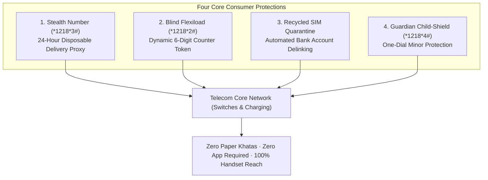
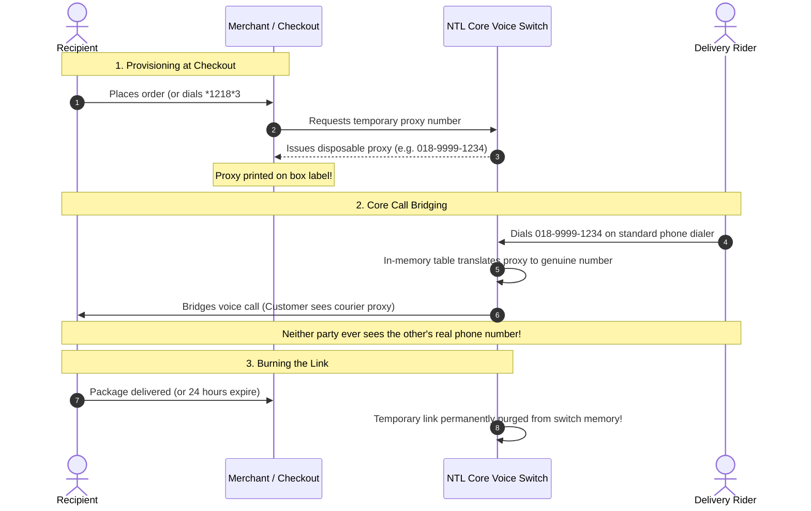
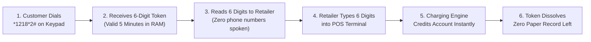

# 🛡️ Consumer & Retail Privacy Shield

> **Parent Topic:** [[00_Master_Navigation_and_Executive_Overview]]  
> **Master Terminology Guide:** [[08_Master_Definitions_Terminology_and_Concepts]]  
> **Slides Covered:**  
> • **Main Deck:** Slide 04 (Network-Layer Consumer Protection), Slide 05 (Consent for Every Handset)  
> • **Backup Deck:** Slide 21 (Consumer Privacy Divider), Slide 22 (Stealth Number Deep-Dive), Slide 23 (Blind Flexiload Deep-Dive), Slide 24 (Recycled SIM Quarantine), Slide 25 (Guardian Child Shield & Consent)

---

## 🎯 Chapter Overview: Protecting Citizens Where They Live

This module covers the frontline consumer products of **NTL Shurokkha (এনটিএল সুরক্ষা)**. 

These tools protect everyday citizens across Bangladesh: students receiving online orders, rural farmers recharging airtime at roadside kiosks, executives using corporate SIMs, and parents sharing smartphones with children.

---

## 📄 Main Deck Slide 04: Network-Layer Consumer Protection

![[project red sky deck final.pdf#page=4]]

### 1. Slide Intent & Context
* **Core Message:** Street-level privacy leaks (e-commerce parcels and roadside recharge notebooks) cannot be solved by apps; they require network-level temporary identity masking.
* **Proven Precedents:** Safaricom Kenya (banning 298,000 paper recharge ledgers) and Vodafone Sakhi India (tokenized airtime top-ups).

### 2. What the Slide Shows & What Each Part Signifies

#### 1. Stealth Number (ছদ্মবেশী মোড) — For Deliveries & Commerce
* **What It Does:** Prevents delivery couriers from acquiring the customer's permanent personal phone number while ensuring full judicial traceability.
* **How It Works:**
  1. The customer requests a temporary proxy via USSD (`*1218*3#`) or an e-commerce platform generates it at checkout.
  2. The temporary proxy number is printed on the cardboard package sticker.
  3. When the courier dials the proxy, NTL's core voice switches bridge the call in temporary memory to the customer's real phone.
  4. The link burns and dissolves after 24 hours, upon delivery confirmation, or manually.
  5. The underlying National ID is unmasked **only upon High Court judicial warrants**.

#### 2. Blind Flexiload — The No-Khata Mandate for Retail Stalls
* **What It Does:** Eliminates handwritten phone numbers from open paper ledgers across 250,000+ retail recharge stalls in Bangladesh.
* **How It Works:**
  1. The customer dials `*1218*2#` on any phone keypad.
  2. The screen displays a temporary **6-digit one-time token** valid for 5 minutes.
  3. The retailer types the 6-digit code into their Point-of-Sale (POS) terminal instead of an 11-digit phone number.
  4. The core charging system credits the account immediately in volatile memory.
  5. The token dissolves; zero customer phone numbers are spoken aloud or written in paper ledgers.

### 3. Anticipated Judge / Executive Q&A
* **Q: Does Stealth Number work if the delivery courier uses a different mobile operator?**
  * **A:** Yes. The courier dials the 11-digit proxy number from any cellular network (GP, Robi, Banglalink). The call routes over the standard national telecom interconnection to NTL's core switch, which translates the proxy to the recipient's genuine line in memory. Neither party ever sees the other's personal number.
* **Q: Will retail shopkeepers refuse to adopt Blind Flexiload if NTL does not pay them a cash subsidy?**
  * **A:** No subsidy is necessary because Blind Flexiload reduces retailer friction: typing 6 digits takes ~2 seconds compared to ~6 seconds for an 11-digit number, increasing counter speed by 50%. Furthermore, built-in checksums reject typing errors instantly, eliminating costly misdial disputes.

---

## 📄 Backup Slide 21: Section Divider — Consumer & Retail Privacy Products

![[project red sky deck final.pdf#page=21]]

### 1. Slide Intent & Context
* **Core Message:** Section divider establishing NTL's commitment to protecting everyday citizens on both basic button phones and smartphones.

---

## 📄 Backup Slide 22: Stealth Number (ছদ্মবেশী মোড) Deep-Dive

![[project red sky deck final.pdf#page=22]]

### 1. Slide Intent & Context
* **Core Message:** Details the technical workflow and legal escrow model of disposable burner numbers.

### 2. Operational Workflow

### 3. Core Concepts Behind the Slide
* **Signaling Header Manipulation:** When the courier dials the proxy, NTL's core voice switch intercepts the call setup packet. The switch rewrites the caller ID headers in volatile memory before forwarding audio, ensuring that both parties' handset call logs record only disposable proxy numbers.
* **Dual-Key Judicial Escrow:** To prevent criminals from abusing disposable numbers for extortion, the cryptographic mapping between the proxy and the subscriber's National ID is locked in an isolated audit database. It can be unmasked **only upon a formal High Court judicial warrant**, requiring dual authorization keys held by the Chief Legal Officer and the Data Protection Officer.

### 4. Anticipated Judge / Executive Q&A
* **Q: Can law enforcement track an illegal threat made through a Stealth Number?**
  * **A:** Absolutely. Unlike untraceable burner apps, every Stealth Number is linked to an authenticated subscriber National ID in an isolated, tamper-evident audit ledger. When presented with a valid High Court judicial warrant, the CLO and DPO unlock the dual-key record to provide full forensic records to authorities.

---

## 📄 Backup Slide 23: Blind Flexiload (The No-Khata Mandate) Deep-Dive

![[project red sky deck final.pdf#page=23]]

### 1. Slide Intent & Context
* **Core Message:** Details the retail airtime tokenization architecture and explains why zero retailer cash subsidies are required.

### 2. Operational Workflow

### 3. Core Concepts Behind the Slide
* **Ephemeral In-Memory Tokens:** When the user dials `*1218*2#`, the charging engine generates a cryptographically random 6-digit token stored in volatile memory with a 5-minute Time-To-Live (TTL). When entered by the retailer, the system matches the token, applies the airtime credit, and instantly purges the token.
* **Why Retailers Adopt with BDT 0 Subsidy:**
  1. **50% Faster Transactions:** Entering 6 digits takes ~2 seconds vs. ~6 seconds for an 11-digit phone number, speeding up retail queues.
  2. **Eliminates Misdials:** 6-digit tokens include mathematical checksum verification. If a shopkeeper mistypes a digit, the POS rejects it before money transfers, eliminating costly dispute reversals.
* **Family Alias (Remote Remittances):** For family members living away from home (e.g., a son in Dhaka sending money to his mother in a village), families can register a permanent **8-digit Family Alias**. The sender quotes the family alias to recharge without exposing the mother's phone number at retail counters.

### 4. Anticipated Judge / Executive Q&A
* **Q: What happens if the 5-minute token expires before the customer reaches the counter?**
  * **A:** The customer simply dials `*1218*2#` again on their keypad. Generating a new code takes 2 seconds and costs nothing.
* **Q: Does the retailer need new hardware to accept 6-digit tokens?**
  * **A:** No. NTL's existing retailer SIM application and POS terminals are updated via an over-the-air (OTA) configuration to accept 6-digit token inputs alongside standard numbers.

---

## 📄 Backup Slide 24: Recycled SIM Quarantine (Severing the Ghost Identity)

![[project red sky deck final.pdf#page=24]]

### 1. Slide Intent & Context
* **Core Message:** Establishes an automated 4-stage quarantine pipeline to prevent new SIM buyers from inheriting previous owners' dormant banking alerts and OTPs.

### 2. The 4-Stage Lifecycle Explained

| Stage 1: Dormancy Period | Stage 2: Quarantine Buffer | Stage 3: Bank Push Delinking | Stage 4: Clean Reissue |
| :--- | :--- | :--- | :--- |
| SIM remains inactive for 12 months under BTRC rules; customer receives notice. | SIM is disconnected and held in total isolation for a 90-day quarantine buffer. | NTL pushes automated webhooks to partner commercial banks and MFS (bKash/Nagad) to delink stale accounts. | Pristine line is reissued to a new subscriber with zero legacy bank alerts, debts, or ghost accounts. |

### 3. Anticipated Judge / Executive Q&A
* **Q: Why do recycled numbers receive strangers' bank alerts today?**
  * **A:** Banks and telecom operators historically operated in silos. When an account holder stopped using a phone number, banks had no automated way of knowing the SIM was recycled. NTL's automated push webhooks inform banking partners before the SIM is resold, protecting both previous owners and new subscribers.

---

## 📄 Main Deck Slide 05 & Backup Slide 25: Consent for Every Handset & Guardian Child-Shield

![[project red sky deck final.pdf#page=5]]
![[project red sky deck final.pdf#page=25]]

### 1. Slide Intent & Context
* **Core Message:** Ensures privacy rights and youth protections work for every citizen in Bangladesh, including non-literate users and keypad phone owners.

### 2. What the Slide Shows & What Each Part Signifies

#### 1. Age Proof Without ID (The "VIP Wristband")
* **What It Does:** Allows users to prove they are over 18 online without disclosing their National ID, birthdate, or photos to gaming or commercial platforms.
* **How It Works (Split-ZK Proof):** Like a VIP concert wristband, the network verifies the subscriber's age against existing verified records and sends a digitally signed mathematical confirmation: `Over 18: YES`. The platform receives cryptographic proof while learning zero personal details.

#### 2. Keypad & Dialect Voice Consent (Digital Inclusion)
* **What It Does:** Enables every citizen to exercise statutory PDPA rights (view, correct, withdraw consent, or request erasure) without needing a smartphone or app.
* **How It Works:**
  * **USSD Menu (`*1218#`):** Simple numbered keypad menus on any button phone.
  * **Dialect Voice IVR (`1218`):** Subscribers can call `1218` and speak naturally in **four major regional dialects**: Chatgaya (চট্টগ্রাম), Sylheti (সিলেট), Noakhailla (নোয়াখালী), and Standard Colloquial Bangla. Citizens say *"হ্যাঁ"* (Yes) or *"না"* (No) to manage permissions and receive an immediate confirmation SMS.

#### 3. Guardian Child-Shield (`*1218*4#`)
* **What It Does:** Protects minors using shared family devices from commercial profiling and targeted advertising, fulfilling **PDPA Section 9 & Definition 2(13)**.
* **How It Works:** A parent dials `*1218*4#` and confirms with their line PIN. That single keypress instructs NTL's core switches to drop third-party ad beacons and removes the line from commercial AI profiling models.

### 3. Anticipated Judge / Executive Q&A
* **Q: Why is dialect voice recognition necessary when USSD exists?**
  * **A:** Millions of citizens in rural Bangladesh have limited literacy or struggle with English-based USSD menus. Providing natural dialect voice interaction in regional tongues ensures genuine digital inclusion under PDPA Section 21.
* **Q: How does the network verify age without storing sensitive biometric data?**
  * **A:** NTL evaluates the mathematical predicate `DateOfBirth <= (CurrentDate - 18)`. If true, the system issues a cryptographically signed boolean token. Third-party platforms verify NTL's public signature without ever touching National IDs or birth records.

---

*Explore how NTL protects financial balances, harmonizes conflicting laws, and monetizes banking APIs:*  
👉 **[[04_Financial_Protection_and_Fintech_Trust]]**
