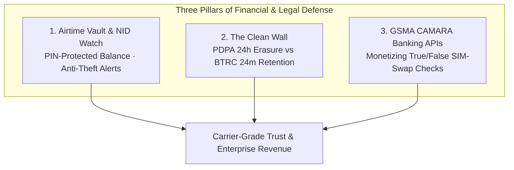
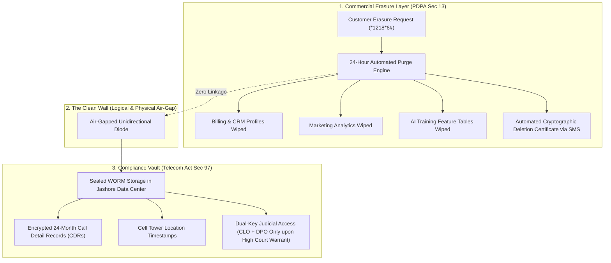
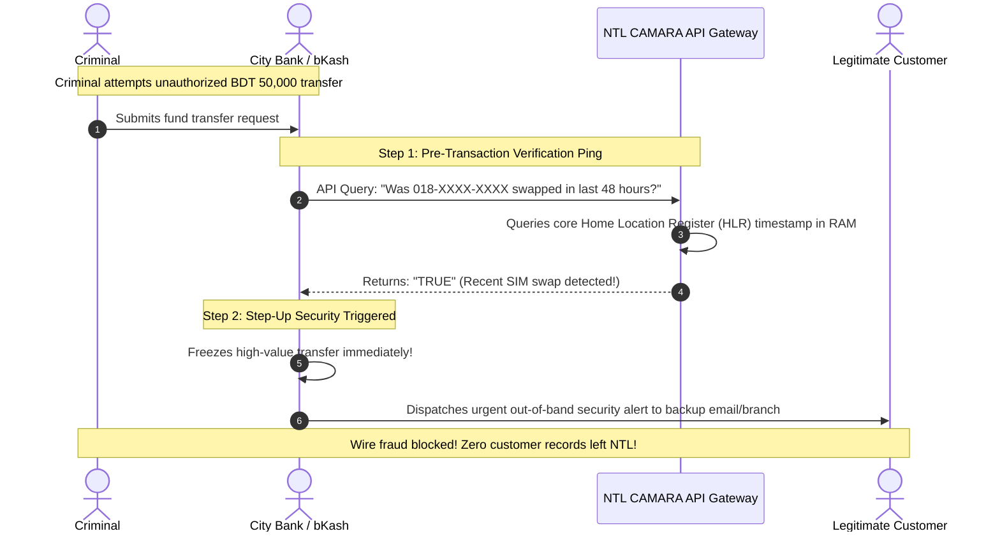

# 💰 Financial Protection & Fintech Trust

> **Parent Topic:** [[00_Master_Navigation_and_Executive_Overview]]  
> **Master Terminology Guide:** [[08_Master_Definitions_Terminology_and_Concepts]]  
> **Slides Covered:**  
> • **Main Deck:** Slide 06 (Financial Protection & Identity Shield)  
> • **Backup Deck:** Slide 26 (B2B Fintech & Legal Divider), Slide 27 (The Clean Wall: PDPA vs BTRC), Slide 28 (CAMARA Bank SIM-Swap API)

---

## 🎯 Chapter Overview: Protecting Money, Identity, and Legal Compliance

When cellular security fails, the consequence is rarely limited to spam calls. In modern Bangladesh, **a compromised phone number means drained mobile balances, hijacked mobile banking accounts (bKash/Nagad), and severe regulatory exposure**.

This module examines how Project Red Sky achieves three breakthroughs:
1. **Consumer Financial Defense:** Permanently stopping unauthorized mobile balance deductions via the **Airtime Vault** and **NID Watch**.
2. **Statutory Harmony (The Clean Wall):** Resolving the direct legal contradiction between 24-hour privacy erasure and 24-month telecom data retention.
3. **High-Margin B2B Monetization:** Transforming privacy compliance into an enterprise revenue stream by selling real-time SIM-swap fraud verification to commercial banks.

---

## 📄 Main Deck Slide 06: Financial Protection & Identity Shield

![[project red sky deck final.pdf#page=6]]

### 1. Slide Intent & Context
* **Core Message:** Locks subscriber airtime balances and personal National IDs against unauthorized deductions and SIM-swap fraud, while turning identity verification into a B2B revenue engine.

### 2. What the Slide Shows & What Each Part Signifies

#### 1. Airtime Vault (`*1218*1#`)
* **Balance Lock:** No third-party digital service (gaming, horoscope, cricket alert) can deduct money from a customer's airtime without explicit USSD PIN authorization.
* **Automatic Refund via Developer Escrow:** If an unauthorized charge ever occurs on an unlocked line, NTL refunds the customer immediately and claws back the funds from a mandatory 14-day developer payout escrow buffer.
* **Sandboxed Developers:** Third-party software developers operate in isolated software sandboxes and receive anonymized billing tokens; they never see actual customer phone numbers.

#### 2. NID Watch (`*1218*5#`)
* **Instant Fraud Alert:** If any new SIM card is registered using the subscriber's National ID, the subscriber's primary phone receives an immediate SMS notification. One keypress locks the unauthorized line.
* **Clean Recycling:** Webhooks notify partner banks to unlink old phone numbers before recycled numbers are resold.
* **Fresh Swap:** If a subscriber's phone number is exposed in a data breach, NTL provides a free replacement SIM and automatically migrates their balance.

#### 3. Bank SIM-Swap Check (GSMA CAMARA Standard)
* **Real-Time Fraud Prevention:** Commercial banks query NTL before approving high-value transactions: *"Was this SIM swapped recently?"*
* **Boolean True/False Response:** NTL returns a single word: `TRUE` or `FALSE`. Zero personal data, call logs, or bank account balances leave NTL.
* **High-Margin Enterprise Revenue:** Banks pay per verification ping (modeled after deployments by Dialog Axiata in Sri Lanka and Telefónica Open Gateway in Brazil).

### 3. Core Concepts Behind the Slide
* **Developer Escrow Buffer:** Instead of paying third-party app developers immediately, NTL holds developer revenue in a 14-day escrow clearinghouse. This ensures that fraudulent or disputed deductions can be refunded to consumers without any balance sheet loss to NTL.
* **SIM-Swap Account Takeover Fraud:** Criminals fraudulently obtain a replacement SIM card for a victim's phone number. Once active, the criminal intercepts one-time passwords (OTPs) sent by banks and mobile wallets to drain the victim's savings. A real-time SIM-swap check stops money transfers if a swap occurred within the last 48 hours.

### 4. Anticipated Judge / Executive Q&A
* **Q: Will third-party app developers abandon NTL's platform if their billing is locked behind an Airtime Vault PIN?**
  * **A:** Legitimate developers welcome it. Silent carrier billing created massive public backlash and distrust. By requiring explicit PIN confirmation, customer trust is restored, chargeback disputes drop, and legitimate developers build sustainable subscription businesses.
* **Q: If NTL automatically refunds unauthorized charges, does that create financial exposure for NTL?**
  * **A:** Zero cash exposure. All refunds are clawed back directly from the mandatory 14-day developer settlement escrow pool before developer payouts are disbursed.

---

## 📄 Backup Slide 26: Section Divider — B2B Fintech & Legal Infrastructure

![[project red sky deck final.pdf#page=26]]

### 1. Slide Intent & Context
* **Core Message:** Section divider introducing NTL's enterprise monetization, commercial banking trust, and regulatory harmony.

---

## 📄 Backup Slide 27: The Clean Wall — PDPA Says Erase. BTRC Says Keep.

![[project red sky deck final.pdf#page=27]]

### 1. Slide Intent & Context
* **Core Message:** Resolves the statutory deadlock between the Data Protection Authority (mandating data erasure) and telecommunications law (mandating data retention).

### 2. The Statutory Deadlock Explained

| 1. Bangladesh PDPA 2026 (Section 13(2)) *(Enforced by: Data Protection Authority)* | 2. Telecommunication Act 2001 (Section 97) *(Enforced by: BTRC & National Security Law)* |
| :--- | :--- |
| • "The data fiduciary MUST permanently erase the customer's personal data upon request within 24 hours of receiving an erasure plea." • **Non-Compliance:** Multimillion-Taka fines and operational suspension. | • "All telecommunications licensees MUST retain subscriber Call Detail Records (CDRs) and tower timestamps for TWENTY-FOUR (24) MONTHS." • **Non-Compliance:** Immediate operating license revocation and criminal charges. |

### 3. The Architectural Solution: The Clean Wall

### 4. Core Concepts Behind the Slide
* **The Legal Principle of *Lex Specialis*:** Under administrative law, a specific statute governing national security (*Lex Specialis*) supersedes a general privacy law (*Lex Generalis*). Telecommunications Act Section 97 requires keeping call records for national defense.
* **Physical and Logical Air-Gap:** Customer marketing profiles, browsing logs, and credit-scoring records are **completely purged within 24 hours**, satisfying PDPA Section 13(2). Meanwhile, raw Call Detail Records (CDRs) are encrypted (AES-256-GCM) and written to **Write-Once-Read-Many (WORM)** storage at an isolated secondary facility in Jashore. These records are inaccessible to marketing or IT staff and can only be opened with a formal High Court judicial warrant.

### 5. Anticipated Judge / Executive Q&A
* **Q: How can NTL prove to the Data Protection Authority that a customer's data was truly deleted?**
  * **A:** When an erasure request is executed across commercial databases, the system generates an automated, cryptographically signed **Deletion Certificate** delivered to the customer via SMS. The certificate logs the exact cryptographic hash of the deleted profile and timestamps, proving compliance without storing any personal records.
* **Q: Can marketing staff query the Jashore compliance vault to recover lost customer data?**
  * **A:** No. The compliance vault is connected via a physical hardware diode (one-way data flow) and is mathematically locked. Querying the vault requires two separate cryptographic smartcards physically held by the Chief Legal Officer and the Data Protection Officer, authorized only under High Court orders.

---

## 📄 Backup Slide 28: CAMARA Bank SIM-Swap API Deep-Dive

![[project red sky deck final.pdf#page=28]]

### 1. Slide Intent & Context
* **Core Message:** Demonstrates how NTL converts identity verification into a profitable enterprise B2B service for commercial banks and mobile financial services (MFS).

### 2. Operational Workflow

### 3. Key Operational Parameters
* **Execution Protocol:** Commercial banks query NTL before approving high-value transactions: *"Was this SIM swapped in the last 48 hours?"*
* **Response Format:** NTL returns a single boolean: **`TRUE`** or **`FALSE`**.
* **Zero Data Leakage:** Zero customer names, National IDs, account balances, or call records leave NTL's core network.
* **Invisible Experience:** For 99.9% of transactions where no SIM swap occurred, the response is `FALSE` in under 30 milliseconds, and the customer's transfer processes with zero friction.
* **Commercial Economics:** 90 million bank queries per year at BDT 1.50 per check generates **+BDT 11.4 Crore/year in gross high-margin B2B revenue**.

### 4. Anticipated Judge / Executive Q&A
* **Q: Why would a commercial bank pay BDT 1.50 per query when they already use SMS OTPs?**
  * **A:** SMS OTPs offer zero protection against SIM-swap fraud because the criminal holds the active SIM and receives the OTP directly. A BDT 1.50 API check is an insignificant operational cost compared to reimbursing a fraudulent BDT 50,000 wire transfer and defending against central bank penalties.
* **Q: Is this an unproven concept?**
  * **A:** No. This exact GSMA CAMARA SIM-swap architecture has been successfully deployed by Dialog Axiata in Sri Lanka and Telefónica Open Gateway across Brazil and Europe. NTL is bringing an established global telecom standard to Bangladesh.

---

*Explore how NTL tracks internal big data pipelines, governs AI systems, and blocks cross-border data leaks:*  
👉 **[[05_Sovereign_AI_Data_Lineage_and_Cyber_Defense]]**
