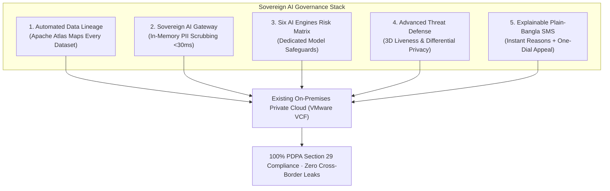

# 🤖 Sovereign AI, Data Lineage & Cyber Defense

> **Parent Topic:** [[00_Master_Navigation_and_Executive_Overview]]  
> **Master Terminology Guide:** [[08_Master_Definitions_Terminology_and_Concepts]]  
> **Slides Covered:**  
> • **Main Deck:** Slide 07 (Enterprise Data & AI Security), Slide 08 (The Six AI Systems Risk Matrix)  
> • **Backup Deck:** Slide 29 (Sovereign AI Divider), Slide 30 (Sovereign Data Gateway), Slide 31 (Stopping AI Attackers & Deepfakes), Slide 32 (Pre-Launch Gates & Plain-Bangla SMS)

---

## 🎯 Chapter Overview: Enterprise AI Governance & Data Sovereignty

Modern enterprise security is no longer just about keeping outside hackers from breaking in. **Today, the biggest data risks occur when internal corporate systems inadvertently export confidential subscriber data to cloud AI services.**

This module examines how Project Red Sky establishes sovereign control over enterprise big data and artificial intelligence:
1. **Uncovering "Dark Lakehouses":** Automated tracking of every customer dataset across internal Hadoop, Spark, and billing databases.
2. **The Sovereign AI Gateway:** Sanitizing analytical prompts in temporary computer memory (<30ms) before external AI models can see them.
3. **Model-Specific Safeguards:** Tailored protections for all six mandated AI engines operating across NTL.
4. **Algorithmic Explainability:** Turning complex AI decisions into plain-Bangla SMS explanation cards with human appeal rights.



---

## 📄 Main Deck Slide 07: Enterprise Governance & AI Security

![[project red sky deck final.pdf#page=7]]

### 1. Slide Intent & Context
* **Core Message:** NTL establishes enterprise data intelligence on existing private cloud infrastructure, ensuring full visibility into data flows and blocking unapproved cross-border data transfers.
* **Answers Senior Management Questions:** Q1 (Data Location), Q2 (Sensitive Data), Q3 (AI Access), and Q5 (Cross-Border Transfer).

### 2. What the Slide Shows & What Each Part Signifies

#### 1. Automated Data Lineage (Apache Atlas + Iceberg)
* **What It Does:** Automatically traces every customer dataset across Hadoop clusters, billing databases, and data science workflows.
* **Vendor Registry:** External partners and software vendors receive anonymized tokens, never raw customer phone numbers.
* **Masked Agent Desk:** Call center staff see masked phone numbers (`01819-XXX-XXX`) in internal CRM portals, preventing rogue employees from harvesting customer lists.

#### 2. Sovereign AI Gateway (Outbound DLP & Firewall)
* **In-Memory PII Scrubber:** Strips phone numbers, National IDs, and customer names in volatile RAM before any analytical prompt leaves NTL's network.
* **Prompt Injection Shield:** Separates system instructions from user inputs, preventing malicious prompts from extracting confidential data (OWASP LLM01).
* **Explainable Outputs:** Converts automated credit and churn decisions into transparent, plain-Bangla SMS cards.

#### 3. Zero-Trust Egress Control (Kernel-Level Traffic Defense)
* **Outbound Content Filtering:** Redacts sensitive personal data in all outbound network traffic.
* **Kernel-Level Blocking:** Drops unapproved network connections to foreign cloud servers at the operating system level.
* **Data Stays in Bangladesh:** Subscriber telemetry stays strictly on sovereign national infrastructure (PDPA Sections 29–30); no machine learning is executed on exposed cell tower masts.

### 3. Core Concepts Behind the Slide
* **Dark Lakehouses:** In large telecom companies, data scientists frequently create temporary database tables to test churn or marketing models. Over time, these tables are forgotten, creating unencrypted, unmapped data stores. **Apache Atlas** automatically maps the ancestry and flow of every table so IT leadership can audit personal data across the company at any time.

### 4. Anticipated Judge / Executive Q&A
* **Q: How does the Masked Agent Desk prevent internal employee data leaks?**
  * **A:** Customer service representatives only see masked numbers by default. If an agent genuinely needs to unmask a number to assist a customer, the system dispatches an instant consent request to the customer's phone. Only upon the customer's approval is the number revealed, and the action is logged permanently in an unalterable audit trail.
* **Q: Why avoid running machine learning models on remote cell tower masts?**
  * **A:** Remote cell towers across rural Bangladesh lack physical armed security. Deploying machine learning models or storing unencrypted customer telemetry on tower edge hardware creates a physical theft and extraction risk. Processing aggregated radio data at central core facilities is significantly more secure.

---

## 📄 Main Deck Slide 08: The Six AI Systems Risk Matrix

![[project red sky deck final.pdf#page=8]]

### 1. Slide Intent & Context
* **Core Message:** Generic corporate policies fail; every artificial intelligence system operates across a distinct attack surface and requires a specific technical control and C-level owner.
* **Direct Alignment:** Fulfills `case.md` requirements for governing all six planned enterprise AI applications.

### 2. The Six AI Systems, Risks, and Controls Explained

| AI System | Owner | Primary Risk & Attack Surface | Technical Safeguard |
| :--- | :--- | :--- | :--- |
| **1. Support Assistant**<br>*(Customer Care)* | CIO / CCO | Prompt injection; customer phone numbers leaking to public cloud LLMs. | On-premises Sovereign Gateway scrubs names, numbers, and NIDs in RAM before prompts leave. |
| **2. Fraud Detection**<br>*(Financial Check)* | CFO / Risk | Collecting excessive customer data; unexplainable fraud flags. | Banks receive a single boolean SIM-swap answer (`TRUE`/`FALSE`); zero call logs leave NTL. |
| **3. Churn Prediction**<br>*(Marketing AI)* | CMO | Algorithmic bias; customer profiles retained longer than legally permitted. | Uses coarse behavioral bands; excludes contact graphs; minors excluded; profile wiped on erasure. |
| **4. Marketing Recs**<br>*(Ad Targeting)* | CMO / CCO | Tracking and profiling minors; commercial ads without affirmative consent. | Lines enrolled in Child-Shield are automatically excluded; requires adult opt-in; contextual offers only. |
| **5. Network Optimize**<br>*(Cell Mast ML)* | CTO | Tower location and radio telemetry data processed or exported abroad. | Trained on regional aggregated hubs with added noise; raw radio telemetry never leaves Bangladesh. |
| **6. Document e-KYC**<br>*(ID Verification)* | CIO | Sensitive National ID photos and facial biometrics exposed to leaks. | Executed in volatile RAM enclaves; text verified, photos discarded immediately; zero photos saved to disk. |

### 3. Anticipated Judge / Executive Q&A
* **Q: Why does the Churn Prediction model use "coarse behavioral bands" instead of detailed contact graphs?**
  * **A:** Analyzing personal contact graphs (who calls whom) invades customer social privacy and creates severe compliance liability under PDPA Section 16. Using coarse behavioral metrics (e.g., total monthly recharge frequency, data bundle usage tiers) provides 95% of the predictive accuracy with zero intrusion into private social relationships.
* **Q: How does document e-KYC comply with biometric privacy if it reads customer faces?**
  * **A:** NTL uses **Zero Biometric Retention**. The facial geometry check runs in temporary computer memory (volatile RAM) to confirm identity against the national database. The moment verification completes, the facial template is deleted (`free()`). No customer facial photos are ever written to hard drives.

---

## 📄 Backup Slide 29: Section Divider — Enterprise Data & AI Governance

![[project red sky deck final.pdf#page=29]]

### 1. Slide Intent & Context
* **Core Message:** Section divider introducing technical deep-dives into the Sovereign AI Gateway, advanced threat defense, and algorithmic explainability.

---

## 📄 Backup Slide 30: Sovereign AI Gateway — In-Memory PII Stripping

![[project red sky deck final.pdf#page=30]]

### 1. Slide Intent & Context
* **Core Message:** Details how NTL scrubs sensitive personal identifiers in memory in under 30 milliseconds before queries reach external AI tools.

### 2. Operational Workflow

```mermaid
sequenceDiagram
    autonumber
    actor Agent as Customer Care Agent
    participant GW as Sovereign AI Gateway (On-Premises RAM)
    participant CloudAI as External Cloud LLM

    Agent->>GW: Submits support query containing customer phone number & NID
    Note over GW: In-Memory Tokenizer detects PII in <30ms!
    GW->>GW: Replaces real identity with synthetic placeholder: "Token_Alpha_99"
    GW->>CloudAI: Sends scrubbed prompt containing "Token_Alpha_99"
    CloudAI-->>GW: Returns troubleshooting response for "Token_Alpha_99"
    GW->>GW: Restores real customer name to the final text; destroys Token_Alpha_99!
    GW-->>Agent: Displays completed, safe troubleshooting advice!
    Note over Agent,CloudAI: External AI provider never saw or saved the customer's personal data!
```

### 3. Core Concepts Behind the Slide
* **In-Memory Tokenization:** Incoming prompts pass through an on-premises proxy that detects Bangladeshi phone numbers and National IDs using pattern recognition. Identifiers are swapped with temporary synthetic tokens in volatile computer memory (RAM). Once the external AI model replies, the original name is restored on the agent's screen, and the temporary token vanishes from RAM.
* **Carrier Latency Budget (<30ms):** Because tokenization runs entirely in RAM without slow hard-drive read/write operations, the entire scrubbing process takes less than 30 milliseconds, ensuring zero perceptible lag for customer support agents.

### 4. Anticipated Judge / Executive Q&A
* **Q: Does this prevent public AI companies from training their models on NTL customer data?**
  * **A:** Yes. Because the external AI model only receives scrubbed prompts with synthetic placeholders (e.g., *"Customer Token_Alpha_99 has a billing inquiry"*), the external provider has no personal data to absorb or retain for future model training.

---

## 📄 Backup Slide 31: Stopping AI Attackers, Deepfakes & Model Inversion

![[project red sky deck final.pdf#page=31]]

### 1. Slide Intent & Context
* **Core Message:** Outlines practical defenses against three advanced AI-assisted cyber threats: deepfake identity fraud, model inversion attacks, and automated data exfiltration.

### 2. The Three Advanced Defenses Explained

#### 1. Deepfake & Biometric Defense (Active 3D Liveness)
* **The Threat:** Criminals create AI-generated deepfake videos or replayed photos to pass online SIM registration e-KYC.
* **The Defense:** NTL deploys dynamic 3D spatial checks and optical camera analysis detecting natural biological skin color variations caused by human heartbeats (blood pulse detection). AI deepfake video injections cannot simulate real biological blood flow in real time.

#### 2. Model Inversion Defense (Differential Privacy)
* **The Threat:** Hackers query a trained machine learning model thousands of times, analyzing slight variations in confidence scores until they mathematically reconstruct the original customer records used during training.
* **The Defense:** When training predictive models, NTL adds calibrated mathematical noise (**Differential Privacy**). This mathematically ensures the model's output remains virtually identical whether any individual customer's data was included in training or not, making it impossible to reverse-engineer individual records.

#### 3. Data Exfiltration Defense (Anomaly Monitoring)
* **The Threat:** Compromised third-party developer accounts scraping customer databases via high-speed API requests.
* **The Defense:** Automated rate-limiting algorithms detect abnormal, high-frequency database queries and sever compromised developer sessions instantaneously.

### 3. Anticipated Judge / Executive Q&A
* **Q: In plain English, what is a model inversion attack and why should management care?**
  * **A:** If a company trains an AI model on customer data, an attacker can repeatedly query that model to extract the exact private customer records it learned from. Differential Privacy injects calibrated mathematical noise during training, ensuring no individual customer record can ever be extracted from the model's weights.

---

## 📄 Backup Slide 32: Pre-Launch Safety Gates & Plain-Bangla SMS Explanations

![[project red sky deck final.pdf#page=32]]

### 1. Slide Intent & Context
* **Core Message:** No AI algorithm enters production without automated safety testing, and all automated decisions affecting citizens must provide an immediate explanation in plain Bangla.

### 2. What the Slide Shows & What Each Part Signifies

#### 1. Automated Risk Gate (ARIA)
* **Mandatory Pre-Launch Scans:** Automated privacy and bias checks embedded into software release pipelines.
* **Verified Training Consent:** Prevents models from entering live production unless the training datasets prove lawful consent under PDPA Section 16.
* **Automated Code Freeze:** Algorithms that fail bias or privacy thresholds are programmatically blocked from connecting to live customer databases.

#### 2. Customer Explanations (PDPA Section 15 Mandate)
* **Plain-Language Reasons:** When an automated algorithm adjusts a customer's credit limit or service tier, the system sends an immediate, clear SMS card in Bangla detailing the top contributing reasons.
* **One-Dial Human Appeal (`*1218#`):** Customers who dispute an automated decision can dial `*1218#` to escalate the matter to a human manager, ensuring human-in-the-loop oversight.

> [!example] Real-Life Transparent SMS Card Delivered to Customer Handset
> **বাংলা এসএমএস বার্তা:**  
> *"আপনার ক্রেডিট লিমিট পুনর্মূল্যায়ন করা হয়েছে। কারণ: গত ৩ মাস নিয়মিত বিল পরিশোধ। বিস্তারিত জানতে অথবা এই সিদ্ধান্তের বিরুদ্ধে আপিল করতে ডায়াল করুন \*১২১৮#।"*  
> *(English: "Your credit limit has been adjusted. Reason: Consistent bill payment over the last 3 months. To learn more or dispute this decision with a human manager, dial \*1218#.")*

### 3. Anticipated Judge / Executive Q&A
* **Q: Why is algorithmic explainability a statutory requirement rather than just good customer service?**
  * **A:** Bangladesh PDPA 2026 Section 15 grants every citizen the legal right to understand the logic behind automated decisions that affect their services or credit. Failing to provide clear reasons and a human appeal option exposes the company to regulatory investigations and fines.

---

*Explore how NTL structures board accountability, protects employee data, and enforces binding covenants:*  
👉 **[[06_Enterprise_Governance_and_Board_Accountability]]**
