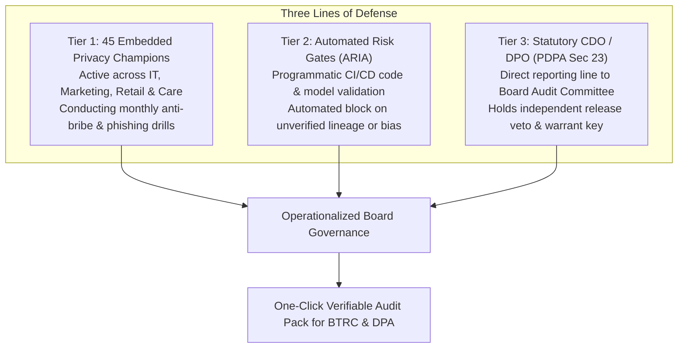

# 🏛️ Enterprise Governance & Board Accountability

> **Parent Topic:** [[00_Master_Navigation_and_Executive_Overview]]  
> **Master Terminology Guide:** [[08_Master_Definitions_Terminology_and_Concepts]]  
> **Slides Covered:**  
> • **Main Deck:** Slide 09 (Organizational Accountability & Legal Harmony), Slide 10 (Eight Management Resolutions)  
> • **Backup Deck:** Slide 33 (Section Divider), Slide 34 (Workforce Privacy & Anti-Shadow AI), Slide 35 (Statutory Truth Table), Slide 37 (The Never List)

---

## 🎯 Chapter Overview: Operationalizing Accountability from Retail to Boardroom

A privacy program fails if it exists only as written legal manuals. If a call-center agent can accept a small bribe to look up a subscriber's call log, or if a software developer can push an unvetted tracking algorithm into production, paper compliance cannot prevent catastrophic regulatory and reputational damage.

This chapter details how Project Red Sky embeds governance directly into daily operations:
1. **Three-Tier Accountability:** Mobilizing 45 embedded Privacy Champions, automated software safety gates in deployment pipelines, and a Board-reporting Data Protection Officer with independent veto power.
2. **Definitive Strategic Resolutions:** Resolving all eight specific corporate and technical concerns raised by executive leadership in `case.md`.
3. **Internal Workforce Privacy & Anti-Shadow AI:** Protecting employee personnel and medical records with dedicated encryption, while providing secure on-premises AI tools so staff do not leak sensitive corporate data to public chatbots.
4. **Statutory Truth Table & The Never List:** Mapping every PDPA legal duty to verifiable technical controls, backed by five non-negotiable covenants enacted directly into the corporate Board Charter.

---

## 📄 Main Deck Slide 09: Organizational Accountability & Legal Harmony

![[project red sky deck final.pdf#page=9]]

### 1. Slide Intent & Context
Slide 09 demonstrates how NTL structures its organizational compliance. Instead of isolating compliance inside a passive legal department, accountability is distributed across three operational lines of defense, anchored by an independent Chief Data Officer (CDO) / Data Protection Officer (DPO) who reports directly to the Board of Directors.

### 2. What the Slide Shows & What Each Part Signifies
* **Tier 1: Embedded Privacy Champions (Frontline Operations):** 45 operational leads embedded directly inside engineering, product marketing, customer care, and retail franchises. They review day-to-day initiatives and participate in regular unannounced anti-phishing and anti-bribe drills.
* **Tier 2: Automated Risk Gates (Software & AI Pipeline Checkpoints):** Automated security and privacy scans integrated directly into NTL’s software deployment pipelines (CI/CD). Algorithms or code updates that fail data lineage tracking or bias audits are programmatically blocked from reaching production.
* **Tier 3: Statutory CDO / DPO (Board-Level Oversight):** Under Section 23 of the Bangladesh Personal Data Protection Act (PDPA), NTL designates an independent Chief Data Officer who reports to the Board Audit Committee rather than commercial business units. By corporate charter, the CDO holds binding veto authority over high-risk data products and holds one of two keys required for judicial lawful interception.
* **The Clean Wall Architecture:** Resolves the statutory tension between consumer privacy (PDPA Section 13(2) right to erasure within 24 hours) and national security (Bangladesh Telecom Act Section 97 requirement to retain call records for 24 months). Commercial analytics profiles are erased in 24 hours, while core call records are sealed inside an air-gapped, write-once vault in Jashore that requires a High Court warrant to unlock.

### 3. Core Concepts Behind the Slide
* **Three Lines of Defense:** An established risk governance model:
  * *First Line:* Operational teams who handle data daily (Developers, Call Center Agents, Retailers).
  * *Second Line:* Automated compliance monitoring systems that enforce security rules programmatically without human bottlenecks.
  * *Third Line:* Independent audit and governance leadership (CDO/DPO) reporting to the Board of Directors, ensuring commercial growth targets do not compromise legal compliance.
* **Independent Veto Power:** To prevent corporate conflicts of interest where commercial executives might override privacy concerns to hit quarterly sales targets, the CDO’s veto cannot be overruled by the CEO or Chief Commercial Officer. It can only be reviewed by the Board Audit Committee.

### 4. Anticipated Judge / Executive Q&A
* **Q1: Why do you need 45 Privacy Champions when the law only requires one named Chief Data Officer?**  
  * **15-Second Defense:** A single executive in Dhaka cannot police 58 million subscriber accounts, hundreds of retail outlets, and daily software commits. Embedding 45 trained champions across IT, care, and marketing ensures privacy review happens before code is shipped or marketing campaigns launch, catching risks at the source.
* **Q2: Does giving the CDO veto power slow down product delivery and commercial innovation?**  
  * **15-Second Defense:** No. Day-to-day checks are automated in CI/CD pipelines through Tier 2 risk gates in minutes. CDO formal review is reserved strictly for high-risk AI deployments and sensitive biometric processing, protecting the business from multi-crore regulatory fines.
* **Q3: How do you handle a conflict between a sales director demanding customer data and the privacy policy?**  
  * **15-Second Defense:** Under NTL's Board Governance Charter, the CDO reports directly to the Board Audit Committee, completely outside the commercial hierarchy. A commercial executive cannot overrule a privacy block.

---

## 📄 Main Deck Slide 10: Eight Questions from Management. Eight Definitive Answers.

![[project red sky deck final.pdf#page=10]]

### 1. Slide Intent & Context
Slide 10 directly addresses and resolves the eight strategic and operational questions raised by senior management during executive strategy reviews (as outlined in `case.md`). It reassures executive leadership that every technical and regulatory blind spot has an assigned owner, an automated architectural control, and verifiable audit proof.

### 2. What the Slide Shows & What Each Part Signifies
* **Q1: Where is customer personal data stored?**  
  * *Resolution:* Fully discovered, tagged, and mapped across all billing engines, private cloud storage, and Hadoop analytics clusters using automated Apache Atlas data lineage.
* **Q2: Which applications process sensitive data?**  
  * *Resolution:* Every internal application is classified under a three-tier sensitivity taxonomy. High-risk systems like e-KYC process national ID photos strictly in volatile in-memory RAM enclaves with zero permanent disk storage.
* **Q3: Which AI systems access customer data?**  
  * *Resolution:* All AI models interact exclusively through a centralized on-premises Sovereign AI Gateway that strips personal identifiers before inference. All six production AI systems operate under strict, isolated policy controls.
* **Q4: Which vendors access personal data?**  
  * *Resolution:* Third-party vendors receive pseudonymized tokens rather than raw phone numbers. External software developers work inside isolated sandbox environments and are logged in a centralized vendor access registry.
* **Q5: What data leaves Bangladesh?**  
  * *Resolution:* Zero restricted citizen personal data leaves the country. Enforced through kernel-level network filters (eBPF) that programmatically drop unauthorized outbound foreign data packets.
* **Q6: Are AI decisions explainable to users?**  
  * *Resolution:* Yes. Subscribers receive plain-Bangla and English SMS decision cards powered by TreeSHAP, explaining the exact factors behind credit scoring, fraud holds, or service actions.
* **Q7: Can we prove compliance during an audit?**  
  * *Resolution:* Yes. Tamper-evident cryptographic logs compile an automated compliance audit package for the Bangladesh Telecommunication Regulatory Commission (BTRC) and the Data Protection Authority in a single click.
* **Q8: Who is accountable across business units?**  
  * *Resolution:* Distributed across three tiers: 45 frontline Privacy Champions, automated CI/CD software gates, and an independent Statutory CDO/DPO reporting directly to the Board of Directors.

### 3. Core Concepts Behind the Slide
* **Comprehensive Accountability Matrix:** Demonstrates that enterprise data protection is not a vague corporate statement; each of management's eight operational concerns is paired with an exact technical mechanism, operational owner, and evidentiary trail.
* **Audit-Proof Readiness:** By shifting from manual spreadsheet audits to real-time programmatic verification, the company eliminates the risk of human error or document falsification during regulatory inspections.

### 4. Anticipated Judge / Executive Q&A
* **Q1: What happens if a third-party vendor demands raw subscriber phone numbers for integration?**  
  * **15-Second Defense:** They are refused. NTL's architecture mandates pseudonymized tokens across all external partner APIs. Raw MSISDNs never cross the boundary into vendor systems, preventing third-party data leaks.
* **Q2: How does the one-click audit pack prove records weren't modified after an incident?**  
  * **15-Second Defense:** Every audit log is stored in an immutable, append-only vault protected by SHA-256 cryptographic hashes and dual-key access. Any post-incident tampering alters the hash chain, triggering an immediate security alert.

---

## 📄 Backup Slide 33: Section Divider — Enterprise Governance & Strategic Trust

![[project red sky deck final.pdf#page=33]]

### 1. Slide Intent & Context
Slide 33 serves as the transition into the technical, operational, and legal governance backup slides, preparing the presentation team to address deep regulatory compliance, workforce data protection, and binding board policies.

---

## 📄 Backup Slide 34: Protecting Employee Data & Blocking Shadow AI

![[project red sky deck final.pdf#page=34]]

### 1. Slide Intent & Context
Slide 34 proves that Project Red Sky applies the same stringent data protection standards internally to NTL’s own workforce. It outlines defenses against insider threats, employee data snooping, and the growing corporate risk of "Shadow AI" (employees secretly pasting proprietary data into public AI chatbots).

### 2. What the Slide Shows & What Each Part Signifies
* **1. HR Data Firewalls & Cryptographic Isolation:**  
  * *Significance:* Employee personal data—such as payroll, performance appraisals, and private medical insurance claims—is encrypted at the database field level using AES-256. Decryption keys are held in a dedicated Key Management Service (KMS) ring accessible only by authorized HR personnel, completely isolated from general IT administrators and commercial analytics teams. Fulfills **PDPA Section 16 (Duty of Confidentiality)**.
* **2. Sanitized Enterprise AI Portal (Anti-Shadow AI Defense):**  
  * *Significance:* Instead of relying on ineffective written bans against public chatbots, NTL provides staff with an approved, internally hosted AI assistant on its private on-premises cloud. Simultaneously, corporate network firewalls drop outbound connections to public AI APIs (`api.openai.com`, `anthropic.com`), preventing accidental leaks of contracts or customer logs.
* **3. Insider Defense & Behavioral Drills:**  
  * *Significance:* Call-center staff and franchise agents undergo unannounced monthly social engineering drills (e.g., simulated phone calls offering cash bribes for subscriber records). Furthermore, departmental privacy compliance scores are tied directly to executive annual bonus calculations.

### 3. Core Concepts Behind the Slide
* **Shadow AI:** The unsanctioned use of third-party public AI tools (such as ChatGPT, Claude, or Grammarly) by employees to draft corporate documents or analyze customer spreadsheets. Because these public services retain prompts for retraining, employees inadvertently leak confidential corporate data.
* **Field-Level Encryption:** Rather than encrypting an entire database server where any database administrator could still read all data rows, field-level encryption encrypts specific sensitive columns (e.g., medical claims, bank accounts) with unique keys, ensuring zero unauthorized internal visibility.

### 4. Anticipated Judge / Executive Q&A
* **Q1: If employees want to use AI to improve productivity, why block public chatbots?**  
  * **15-Second Defense:** Banning AI lowers productivity, but public chatbots store prompts on foreign servers, violating PDPA Section 29. We provide an internal, approved AI portal on NTL's private cloud that gives employees full LLM productivity while keeping all corporate data strictly within our sovereign network.
* **Q2: How do simulated bribe drills work without damaging employee morale?**  
  * **15-Second Defense:** Drills are treated as educational safety training, similar to fire drills. Staff who detect and report simulated bribes receive public recognition, while those who fail receive supportive retraining rather than immediate punitive measures.

---

## 📄 Backup Slide 35: Statutory Truth Table — Every Duty Has an Owner and a Proof

![[project red sky deck final.pdf#page=35]]

### 1. Slide Intent & Context
Slide 35 serves as the definitive legal-technical bridge. It maps each core mandate of the Bangladesh Personal Data Protection Act (PDPA) 2026 directly to an automated technical system and a verifiable cryptographic proof, demonstrating that compliance is operational rather than theoretical.

### 2. What the Slide Shows & What Each Part Signifies

| Statutory Duty | PDPA Section | NTL Shurokkha Technical Control | Verifiable Audit Proof |
| --- | --- | --- | --- |
| **Child Protection** | Sec 9 & Def. 2(13) | Guardian Child-Shield via `*1218#`; automatic ad-beacon drop at core telecom switch. | Cryptographic Parental Consent Record & Zero-Ad Core Enforcement Logs. |
| **Right to Erasure** | Sec 13(2) | Commercial profile 24-hour purge and backup cryptographic key shredding. | Automated Cryptographic Deletion Certificate delivered to subscriber via SMS. |
| **Duty of Confidentiality** | Sec 16 | Sovereign AI Gateway stripping personal identifiers in volatile RAM (<30ms). | De-identified query execution logs confirming zero raw personal data retention. |
| **Statutory Chief Data Officer** | Sec 23 | Independent CDO/DPO reporting directly to Board Audit Committee with veto power. | Corporate Board Charter & binding product launch sign-off ledger. |
| **Lawful Interception Harmonization** | Sec 24 | The Clean Wall: air-gapped, write-once compliance vault in Jashore. | Dual-key judicial High Court warrant access log. |
| **Cross-Border Data Restrictions** | Sec 29 | Sovereign national residency; eBPF kernel network boundary packet filter. | Kernel-level outbound boundary drop logs. |

### 3. Core Concepts Behind the Slide
* **Statutory Mapping:** Regulators evaluate telecom operators on demonstrable technical controls, not good intentions. This matrix guarantees that when the Data Protection Authority conducts an inspection, NTL can present an unbroken chain of forensic evidence for every legal requirement.
* **Cryptographic Erasure (Key Shredding):** In enterprise backups, overwriting petabytes of tape or cold storage immediately upon an erasure request is computationally impractical. Instead, NTL encrypts each subscriber's profile with a unique individual key. When a user requests erasure, that unique key is permanently destroyed, rendering all historical backup copies mathematically unreadable within seconds.

### 4. Anticipated Judge / Executive Q&A
* **Q1: How do you satisfy the PDPA 24-hour erasure rule if telecom law mandates keeping call records for 2 years?**  
  * **15-Second Defense:** Through our "Clean Wall" architecture. Under PDPA Section 13(2), commercial advertising and marketing profiles are purged within 24 hours. Under Telecom Act Section 97, mandatory call detail records are sealed in an isolated, air-gapped vault accessible only by judicial warrant.
* **Q2: What happens if an external auditor challenges the authenticity of your deletion certificates?**  
  * **15-Second Defense:** Deletion certificates are signed with a tamper-evident SHA-256 hash at the exact millisecond of key shredding and logged in an immutable append-only ledger, providing indisputable mathematical proof.

---

## 📄 Backup Slide 37: The "Never List" — Five Binding Board Promises

![[project red sky deck final.pdf#page=37]]

### 1. Slide Intent & Context
Slide 37 outlines five binding corporate commitments formally enacted into NTL’s Board Governance Charter. It establishes clear, uncrossable ethical and operational boundaries that distinguish NTL from competitors, turning trust into a lasting commercial advantage.

### 2. What the Slide Shows & What Each Part Signifies
* **1. NEVER SELL LOCATION DATA:** Cellular tower coordinates and subscriber mobility trails are never sold, leased, or shared with commercial data brokers or advertising networks.
* **2. NEVER PERMIT SILENT CHARGES:** Airtime balances are locked by default against third-party VAS charges. Zero recurring subscription deductions can occur without explicit, two-factor USSD PIN confirmation.
* **3. NEVER PROFILE CHILDREN:** Mobile lines registered under Guardian Child-Shield are permanently and completely excluded from behavioral AI scoring, commercial analytics, and advertising targeting.
* **4. NEVER EXPORT DATA OVERSEAS:** Citizen personal records, national IDs, and radio network telemetry remain strictly on sovereign Bangladeshi soil (complying with PDPA Section 29).
* **5. NEVER PROFIT FROM BREACHES:** If a subscriber’s mobile number is compromised in a verified corporate data breach, NTL provides a free replacement SIM, zero-fee balance transfer, and automatic refunds for any unauthorized charges.

### 3. Core Concepts Behind the Slide
* **Enacted Board Covenants:** Unlike marketing slogans, which can be altered or abandoned by executive discretion, board covenants are binding corporate policies. Breaching a board covenant exposes leadership to formal governance liability, ensuring long-term institutional adherence.
* **Trust as a Commercial Moat:** In emerging telecommunications markets, consumer distrust over silent balance deductions and unwanted marketing calls drives churn. By publicly and permanently renouncing predatory practices, NTL builds unmatched subscriber loyalty and defends its market share.

### 4. Anticipated Judge / Executive Q&A
* **Q1: Does promising never to sell location data reduce potential high-margin enterprise revenue?**  
  * **15-Second Defense:** Raw location data sales carry severe legal liability under the PDPA. Instead, we generate safe, high-margin revenue through CAMARA fraud-check APIs, verifying whether a phone is in a safe location for bank transactions without ever selling or exposing subscriber travel histories.
* **Q2: If an executive breaks one of these five rules to hit a quarterly target, what enforces the promise?**  
  * **15-Second Defense:** The Never List is enacted in the Board Charter and enforced programmatically. Automated CI/CD gates and network egress filters physically block unauthorized data exports or silent billing triggers, preventing human bypass.

---

*Continue to the financial engine, ROI calculations, and canary deployment roadmap:*  
👉 **[[07_Financial_Engine_ROI_and_Execution_Roadmap]]**
