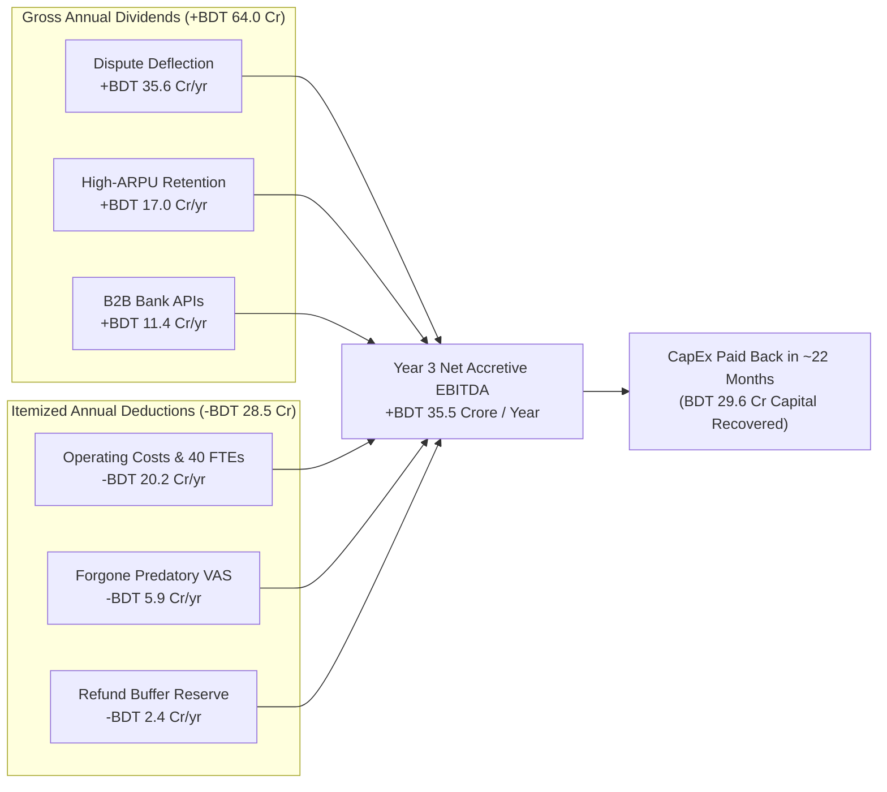

# 📈 Financial Engine, ROI & Execution Roadmap

> **Parent Topic:** [[00_Master_Navigation_and_Executive_Overview]]  
> **Master Terminology Guide:** [[08_Master_Definitions_Terminology_and_Concepts]]  
> **Slides Covered:**  
> • **Main Deck:** Slide 11 (Measuring the Impact & Financial Model)  
> • **Backup Deck:** Slide 36 (The Four Phased Milestones & Execution Roadmap)

---

## 🎯 Chapter Overview: Turning Privacy into an Accretive Commercial Engine

In corporate telecommunications, data privacy and cybersecurity proposals are often perceived as non-revenue-generating cost centers. Security teams request capital expenditure, promise zero direct revenue, and warn of regulatory penalties.

Slide 11 and Backup Slide 36 dismantle this assumption. They present an audited, mathematically grounded financial model demonstrating that Project Red Sky is a **net-profitable, accretive commercial investment**:
1. **Accretive EBITDA:** Generates **+BDT 35.5 Crore in net annual EBITDA** by Year 3.
2. **Rapid Capital Recovery:** Recovers its **BDT 29.6 Crore CapEx in ~22 months (about 2 years)**.
3. **Downside Resilience:** Survives extreme sensitivity testing; even if churn reduction drops to zero, the project achieves full capital payback in 32 months.
4. **Disciplined Staged Execution:** Deployed across four 6-month milestones over 24 months, with strict stage-gate capital releases tied to verified operational KPIs.

---

## 📄 Main Deck Slide 11: Measuring the Impact (The Financial Model)

![[project red sky deck final.pdf#page=11]]

### 1. Slide Intent & Context
Slide 11 provides the executive business case required by the CEO and Board of Directors. It balances audited operating deductions and forgone revenues against three quantifiable recurring dividends, proving that data protection strengthens NTL's operating margins.

### 2. What the Slide Shows & What Each Part Signifies
* **Gross Annual Dividends (+BDT 64.0 Crore / Year):**
  * *Dispute Deflection (+BDT 35.6 Cr/yr):* Third-party VAS deductions drive ~8.98 million billing disputes to call centers annually. At a verified industry cost benchmark of **BDT 45 per dispute call** (covering agent handling time, telecom trunk minutes, and tier-2 escalation), deflecting 88% of these calls via the PIN-locked Airtime Vault saves BDT 35.56 Crore annually.
  * *High-ARPU Retention (+BDT 17.0 Cr/yr):* NTL's top 1.2 million elite post-paid subscribers (averaging BDT 800/month ARPU) generate BDT 1,152 Crore annually. Addressing recycled SIM vulnerabilities and silent VAS deductions defends this base against porting out to competitors, preserving high-margin recurring telecom EBITDA (55% contribution margin).
  * *B2B CAMARA Bank APIs (+BDT 11.4 Cr/yr):* Monetizes fraud-prevention telemetry by selling real-time SIM-swap verification queries to commercial banks and mobile financial service (MFS) providers at BDT 1.50 per query across 90 million annual banking checks (85% software gross margin).
* **Itemized Operating Deductions (−BDT 28.5 Crore / Year):**
  * *OpEx & 40 Dedicated FTEs (−BDT 20.2 Cr/yr):* Fully funds 40 specialized engineering, DevOps, and compliance personnel, along with ongoing private cloud software licensing, server electricity, and hardware maintenance.
  * *Forgone Predatory VAS Billing (−BDT 5.9 Cr/yr):* Transparently accounts for the intentional elimination of misleading third-party subscription billings to eliminate brand erosion.
  * *Refund Buffer Reserve (−BDT 2.4 Cr/yr):* Dedicated operational cash reserve enabling customer care agents to issue instant, friction-free refunds for any accidental charges.
* **Net Accretive EBITDA & Payback Horizon:**
  * Subtracting itemized costs from gross dividends yields **+BDT 35.5 Crore in net accretive EBITDA per year** in Year 3.
  * The total capital expenditure of **BDT 29.6 Crore** (phased: BDT 18.4 Cr in Year 1, BDT 11.2 Cr in Year 2) achieves full capital recovery in **~22 months**.
  * Sweating existing private cloud infrastructure (VMware Cloud Foundation) avoids over **BDT 65 Crore** in unrecoverable foreign public cloud and new hardware outlays.

### 3. Core Concepts Behind the Slide
* **Accretive EBITDA:** Earnings Before Interest, Taxes, Depreciation, and Amortization that directly increases total enterprise operating profitability, rather than merely shifting existing revenues between business units.
* **Dispute Call Unit Economics (BDT 45 Benchmark):** In telecom contact centers, handling an angry billing dispute requires an average of 4.5 minutes of live agent time, interactive voice response (IVR) telephony port capacity, billing system database query overhead, and supervisor review. The BDT 45 benchmark represents the fully loaded operational cost per handled complaint.
* **Capital Sweating:** Maximizing the return on existing corporate assets before approving new capital expenditure. By running the Sovereign AI Gateway and pseudonymization pipelines on NTL's existing private cloud servers, capital expenditure is kept to BDT 29.6 Cr.

### 4. Anticipated Judge / Executive Q&A
* **Q1: How do you defend the BDT 45 call center cost benchmark?**  
  * **15-Second Defense:** The BDT 45 benchmark is based on verified contact center unit economics: 4.5 minutes of agent handling time, telecom trunk minute charges, database query overhead, and supervisory escalations required to investigate carrier billing disputes.
* **Q2: Why voluntarily give up BDT 5.9 Crore in third-party VAS revenue?**  
  * **15-Second Defense:** Silent VAS drains cause 8.98 million customer care disputes costing BDT 35.6 Crore and drive high-value subscriber churn. Giving up BDT 5.9 Crore in predatory billing saves over BDT 52 Crore in care expenses and retained customer gross margin.
* **Q3: What happens to your payback if commercial banks take longer to adopt your CAMARA APIs?**  
  * **15-Second Defense:** Our financial model is stress-tested. Even if bank API adoption is delayed, dispute deflection and churn defense alone generate +BDT 52.6 Crore in gross annual savings, recovering the entire BDT 29.6 Crore CapEx within 26 months.
* **Q4: What if churn defense delivers 0% results?**  
  * **15-Second Defense:** Our 32-month downside stress test proves that even if zero customer churn is prevented, dispute deflection and B2B bank APIs alone recover all invested capital in under 3 years.

---

## 📄 Backup Slide 36: Four Phased Milestones (The 24-Month Execution Roadmap)

![[project red sky deck final.pdf#page=36]]

### 1. Slide Intent & Context
Slide 36 demonstrates that Project Red Sky is structured as an operationally de-risked engineering rollout. It breaks implementation into four 6-month milestones over a 24-month horizon, governed by strict capital stage-gates to eliminate execution risk.

### 2. What the Slide Shows & What Each Part Signifies
* **Phase 1: Pilot & Core Hardening (Months 1–6):**
  * *Deliverables:* Deploy the on-premises Sovereign AI Gateway to scrub PII; roll out Blind Flexiload across a 25,000-kiosk pilot in high-density urban and rural test districts; activate the USSD Airtime Vault (`*1218#`).
  * *Stage-Gate 1:* Phase 2 capital is unlocked only after the 25k kiosk pilot achieves verified adoption and zero core billing latency.
* **Phase 2: Mass Retail Rollout & Voice IVR (Months 7–12):**
  * *Deliverables:* Expand Blind Flexiload across 250,000 retail touchpoints nationwide; launch spoken consent IVR supporting 4 regional dialects; deploy nationwide Guardian Child-Shield.
  * *Stage-Gate 2:* Full technical review before opening external enterprise integration APIs.
* **Phase 3: B2B Monetization & Ecosystem Expansion (Months 13–18):**
  * *Deliverables:* Commercial launch of CAMARA SIM-Swap Query APIs with top commercial banks and MFS providers; launch delivery proxy webhooks for e-commerce and courier partners.
* **Phase 4: Maturity, Audit-Proofing & Steady State (Months 19–24):**
  * *Deliverables:* Operationalize the one-click regulatory audit pack for BTRC and the Data Protection Authority; achieve fully self-funding operational steady state where B2B revenues exceed ongoing maintenance OpEx.

```mermaid
gantt
    title NTL Shurokkha 24-Month Implementation Roadmap
    dateFormat  X
    axisFormat Month %s

    section Phase 1: Pilot
    Sovereign AI Gateway Setup         :active, p1_1, 0, 6
    25k Kiosk Blind Flexiload Pilot    :active, p1_2, 2, 6
    Airtime Vault USSD Launch          :active, p1_3, 3, 6
    Stage-Gate 1 Capital Audit         :crit, p1_gate, 5, 6

    section Phase 2: Mass Rollout
    250k Safe Shops Retail Rollout     :p2_1, 6, 12
    Dialect Voice IVR Launch           :p2_2, 7, 12
    Guardian Child-Shield Nationwide   :p2_3, 8, 12
    Stage-Gate 2 Integration Review    :crit, p2_gate, 11, 12

    section Phase 3: B2B Expansion
    CAMARA Bank SIM-Swap APIs          :p3_1, 12, 18
    E-Commerce Delivery Proxy Webhooks :p3_2, 13, 18

    section Phase 4: Maturity
    1-Click Regulatory Audit Pack      :p4_1, 18, 24
    Self-Funding Steady State Reached  :p4_2, 20, 24
```

### 3. Core Concepts Behind the Slide
* **Capital Stage-Gate Governance:** A financial management discipline where investment funds are not released as a single lump sum. Phase 2 funding (BDT 11.2 Cr) remains locked in corporate treasury until Phase 1 proves pilot adoption KPIs, eliminating large-scale capital waste.
* **Blue-Green / Canary Telecom Deployment:** Upgrading critical telecommunication infrastructure without service downtime. Core network routing microservices are deployed on parallel virtual clusters. Live subscriber traffic is shifted gradually (5% -> 25% -> 100%) while monitoring SS7 and SIP call completion rates in real time. If an anomaly occurs, traffic rolls back instantaneously with zero dropped calls.

### 4. Anticipated Judge / Executive Q&A
* **Q1: What prevents Phase 1 from exceeding its 6-month timeline?**  
  * **15-Second Defense:** Phase 1 uses existing private cloud hardware and established USSD infrastructure rather than unvetted new technologies. The 25k kiosk pilot operates through existing SIM toolkit menus, requiring zero hardware replacement in retail shops.
* **Q2: What happens if retail shop owners resist the Blind Flexiload rollout in Phase 2?**  
  * **15-Second Defense:** Retailer friction is reduced: entering a 6-digit code is faster and has fewer typos than entering an 11-digit phone number. Furthermore, safe shops receive official certification marketing collateral, attracting privacy-conscious female and family recharge traffic.
* **Q3: How do you guarantee zero downtime on core billing during network upgrades?**  
  * **15-Second Defense:** All network routing microservices follow canary blue-green deployments. Live signaling traffic is shifted in small increments with automated telemetry rollback triggers, ensuring continuous 99.999% carrier-grade availability.

---

## 💡 Executive Summary of Financials & Execution

1. **Net-Profitable Investment:** Project Red Sky delivers **+BDT 35.5 Crore in net accretive EBITDA per year** by Year 3.
2. **Rapid Capital Payback:** The **BDT 29.6 Crore** phased CapEx is fully recovered in **~22 months**.
3. **Sweated Cloud Infrastructure:** Reusing NTL's existing private cloud saves over **BDT 65 Crore** in hardware outlays.
4. **Resilient Downside Protection:** Even under catastrophic zero-churn conditions, bank API revenues recover all capital within 32 months.
5. **Stage-Gated Rollout:** 24-month roadmap with four 6-month milestones and strict capital gates, ensuring zero execution and operational risk.

---

*For instant reference to any technical term, legal statute, or abbreviation, consult the complete master encyclopedia:*  
👉 **[[08_Master_Definitions_Terminology_and_Concepts]]**
