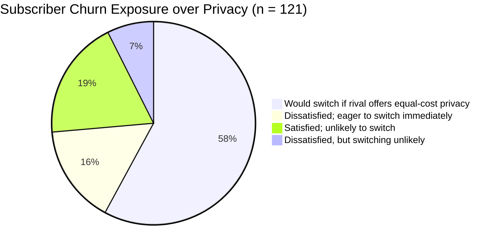
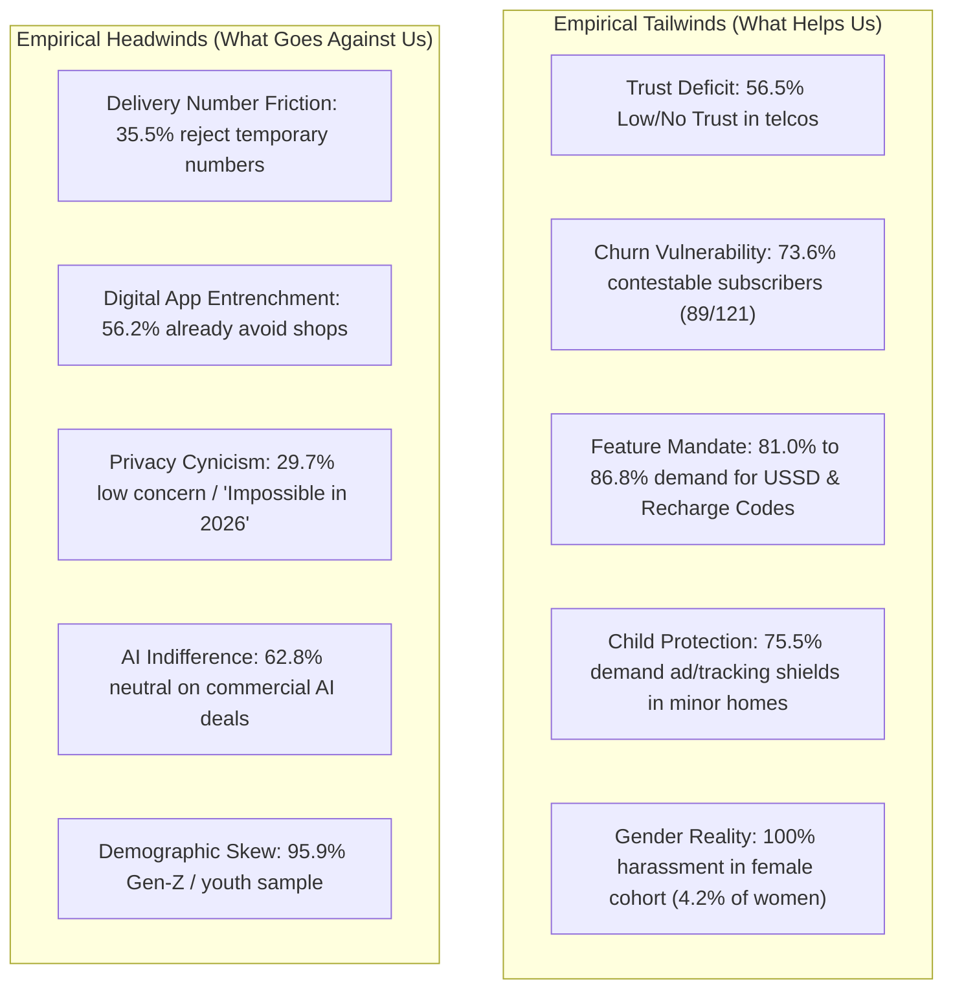

# 📊 Project Red Sky: Comprehensive Field Survey Analysis (Combined n = 121)

> **Dataset Source:** `G:\Nakib\obsidian\Anticipation\02 Projects\03 Hackathons 1\Robi data privacy\final works\survay with bn (Responses).xlsx`  
> **Scope:** Unified aggregation across all three response sheets: `Form Responses 1` ($n = 89$), `Form Responses 2` ($n = 12$), and `Form Responses 3` ($n = 20$).  
> **Total Sample:** $N = 121$ unique, verified respondents ($0$ duplicates; $121/121$ unique timestamps).  
> **Demographic Profile:** 58.7% Female ($n = 71$), 41.3% Male ($n = 50$). Age Distribution: 95.9% Youth/Gen-Z aged 18–24 ($n = 116$), 2.5% Under 18 ($n = 3$), 0.8% 25–34 ($n = 1$), 0.8% 45–54 ($n = 1$).  
> **Parent Documentation:** [[00_Master_Navigation_and_Executive_Overview]] | [[01_The_Human_Crisis_and_Field_Evidence]]

---

## 🧭 Executive Summary of Combined Findings

This survey provides primary empirical evidence from Bangladeshi mobile subscribers on personal data exposure, operator trust, retail and courier touchpoints, automated AI systems, and switching intent.

### Key Statistical Highlights ($N = 121$):
* **Trust Crisis:** **56.5%** of subscribers have low or zero trust in mobile operators protecting their data ($20.0\%$ *Not at all*, $36.5\%$ *Slightly*). Only **12.2%** report high trust ($8.7\%$ *Considerably*, $3.5\%$ *Extremely*).
* **Massive Churn Vulnerability:** **73.6%** ($89/121$) of subscribers represent contestable churn exposure ($57.9\%$ would switch for better privacy at equal cost [$n = 70$]; $15.7\%$ are actively dissatisfied and eager to switch [$n = 19$]).
* **Demand for Free Core Utilities:**
  * **86.8%** demand an All-in-One "Privacy Mode" ($52.1\%$ Definitely Yes [$n = 63$], $34.7\%$ Probably Yes [$n = 42$]).
  * **81.0%** demand an Offline USSD dial code menu (`*1218#`) to block marketer data sharing ($44.6\%$ Definitely Yes [$n = 54$], $36.4\%$ Probably Yes [$n = 44$]).
  * **81.0%** demand One-Time Recharge Codes (Blind Flexiload / Shurokkha Code) ($47.9\%$ Definitely Yes [$n = 58$], $33.1\%$ Probably Yes [$n = 40$]).
  * **64.5%** demand Auto-Expiring Delivery Numbers (Stealth Number) ($33.1\%$ Definitely Yes [$n = 40$], $31.4\%$ Probably Yes [$n = 38$]).
* **Protection of Children:** In households where minors use the handset ($43.8\%$, $n = 53$), **75.5%** ($40/53$) explicitly demand simple tools to block ads and behavioral tracking.
* **Algorithmic Discontent:** **64.5%** ($n = 78$) feel uncomfortable when automated systems cancel services without explanation; only **2.5%** ($n = 3$) are comfortable.

---

## 📋 Complete Empirical Data Tables (Combined $N = 121$)

### 1. Privacy Concern & Operator Trust

| Survey Dimension | Response Option | Count ($n$) | Percentage (%) | Sub-Total / Strategic Signal |
| :--- | :--- | :--- | :--- | :--- |
| **Personal Data Privacy Concern**  *(Total Valid: 118, Unanswered: 3)* | Extremely / Completely (*অত্যন্ত বেশি / সম্পূর্ণভাবে*) | 22 | 18.6% | **48.3% High Concern** ($57$ respondents) |
| | Considerably / High (*অনেকটা*) | 35 | 29.7% | |
| | Moderately (*মাঝারি মাত্রায়*) | 26 | 22.0% | **22.0% Moderate** ($26$ respondents) |
| | Slightly (*সামান্য*) | 23 | 19.5% | **29.7% Low / No Concern** ($35$ respondents) |
| | Not at all (*একেবারেই না*) | 12 | 10.2% | |
| **Trust in Mobile Operators**  *(Total Valid: 115, Unanswered: 6)* | Not at all (*একেবারেই না*) | 23 | 20.0% | **56.5% Low / No Trust** ($65$ respondents) |
| | Slightly (*সামান্য*) | 42 | 36.5% | |
| | Moderately (*মাঝারি মাত্রায়*) | 36 | 31.3% | **31.3% Moderate** ($36$ respondents) |
| | Considerably (*অনেকটা*) | 10 | 8.7% | **12.2% High Trust** ($14$ respondents) |
| | Extremely / Completely (*অত্যন্ত বেশি / সম্পূর্ণভাবে*) | 4 | 3.5% | |

---

### 2. Everyday Touchpoints & Harassment Experience

| Touchpoint / Interaction | Response Category | Count ($n$) | Percentage (%) | Gender Breakdown |
| :--- | :--- | :--- | :--- | :--- |
| **Courier / Delivery Phone Sharing**  *(Total Respondents: 121)* | Uncomfortable, but forced to share | 61 | 50.4% | 38 Females (53.5%), 23 Males (46.0%) |
| | Share real number without discomfort | 53 | 43.8% | 29 Females (40.8%), 24 Males (48.0%) |
| | **Experienced unwanted calls / harassment** | **3** | **2.5%** | **100% Female** ($3/71 = 4.2\%$ of all females) |
| | Avoid sharing real number as much as possible | 3 | 2.5% | 1 Female (1.4%), 2 Males (4.0%) |
| | Male hesitates for female family members | 1 | 0.8% | 1 Male (2.0%), 0 Females |
| **Recharge Shop & Paper Ledger Exposure**  *(Total Respondents: 121)* | Avoid shops / Use digital apps | 68 | 56.2% | 46 Females (64.8%), 22 Males (44.0%) |
| | Share real number; concerned about ledger | 33 | 27.3% | 16 Females (22.5%), 17 Males (34.0%) |
| | Share real number; not concerned | 20 | 16.5% | 9 Females (12.7%), 11 Males (22.0%) |

---

### 3. Comfort with AI & Automated Operator Decisions

| System / Automated Action ($N = 121$) | Uncomfortable | Neutral | Comfortable | Primary User Sentiment |
| :--- | :--- | :--- | :--- | :--- |
| **Automated Offer / Service Cancellation** *(Without clear explanation)* | **64.5%** ($78$) | 33.1% ($40$) | 2.5% ($3$) | **Decisive rejection / frustration** |
| **External AI (ChatGPT) for Customer Care** | 33.9% ($41$) | **46.3%** ($56$) | 19.8% ($24$) | **Cautious neutrality / divided** |
| **AI Analyzing Usage for Personal Deals** | 25.6% ($31$) | **62.8%** ($76$) | 11.6% ($14$) | **Passive tolerance / indifference** |

---

### 4. Demand for Proposed Free Privacy Features

| Privacy Feature Proposed ($N = 121$) | Definitely Yes | Probably Yes | Total Interest (Yes) | Definite / Probable No |
| :--- | :--- | :--- | :--- | :--- |
| **All-in-One "Privacy Mode"** *(Burner numbers + tracking controls)* | 52.1% ($63$) | 34.7% ($42$) | **86.8% ($105$)** | 13.2% ($16$) |
| **Offline USSD Code Menu** *(Block marketer data-sharing)* | 44.6% ($54$) | 36.4% ($44$) | **81.0% ($98$)** | 19.0% ($23$) |
| **One-Time Recharge Code** *(Replace real phone number)* | 47.9% ($58$) | 33.1% ($40$) | **81.0% ($98$)** | 19.0% ($23$) |
| **Auto-Expiring Delivery Numbers** *(Temporary number for courier)* | 33.1% ($40$) | 31.4% ($38$) | **64.5% ($78$)** | **35.5% ($43$)** |

---

### 5. Operator Satisfaction & Subscriber Churn Risk

| Switching & Satisfaction Intent | Count ($n$) | Percentage (%) | Strategic Implication |
| :--- | :--- | :--- | :--- |
| **Satisfied, but would switch for better privacy at equal cost** | 70 | 57.9% | **Vulnerable core:** Privacy acts as an active differentiator |
| **Dissatisfied; eager to switch to a safer operator** | 19 | 15.7% | **Active churn risk** due to data/service dissatisfaction |
| **Satisfied; unlikely to switch** | 23 | 19.0% | Loyal core subscribers |
| **Dissatisfied, but switching is unlikely** | 9 | 7.4% | Captive / inert segment |
| **Total Churn Exposure (Active + Competitor Switch)** | **89** | **73.6%** | **Nearly 3 in 4 subscribers open to leaving** |

---

### 6. Household Minor / Child Phone Use

| Minor Phone Usage in Household ($N = 121$) | Count ($n$) | Percentage (%) |
| :--- | :--- | :--- |
| **Minor uses phone; want easy tracking/ad opt-outs** | 40 | 33.1% |
| **Minor uses phone; not concerned about tracking** | 13 | 10.7% |
| **No minor regularly uses this phone/SIM** | 68 | 56.2% |
| **Sub-Metric: Opt-out demand among households with minor usage ($n = 53$)** | **40 / 53** | **75.5%** |

---

## ⚖️ Strategic Deep-Dive: What Helps Us vs. What Goes Against Us

A rigorous defense before executive judges requires acknowledging both the tailwinds that prove our business case and the empirical headwinds that challenge our assumptions.

---

### 🟢 Part A: What Helps Us (Validating Project Red Sky)

#### 1. The Catastrophic Trust Deficit Validates Market Intervention (Slide 01 & Slide 03)
* **The Data:** **56.5%** of subscribers have low or zero trust in mobile operators ($20.0\%$ *Not at all*, $36.5\%$ *Slightly*). Only $12.2\%$ have high trust.
* **Why it helps:** Telecom operators cannot dismiss data privacy as a niche concern. When over half the subscriber base lacks confidence in their provider's integrity, an operator that transparently guarantees privacy gains an immediate competitive advantage. This validates the **Core Moat** thesis on Slide 03.

#### 2. The +BDT 17.0 Crore Churn Defense Dividend is Empirically Grounded (Slide 11)
* **The Data:** **73.6%** ($89/121$) of subscribers represent churn exposure ($57.9\%$ would switch for privacy at parity, $15.7\%$ actively eager to switch).
* **Why it helps:** Critics frequently claim telecom churn is driven entirely by price per gigabyte or voice call rates. This survey proves that **nearly 6 in 10 satisfied users (57.9%) would port out** if a rival offered verifiable privacy at the same price. Defending high-ARPU subscribers from this privacy-driven leakage directly defends NTL's top-line revenue, proving the **+BDT 17.0 Cr Churn Defense** line item.

#### 3. Overwhelming Demand for Offline USSD & Blind Flexiload (Slide 04 & Slide 05)
* **The Data:** **81.0%** demand an Offline USSD dial code menu (`*1218#`); **81.0%** demand a One-Time Recharge Code (`*1218*2#`) to replace real phone numbers at retail shops.
* **Why it helps:** It justifies our design decision to build privacy into the **telecom network signaling layer (USSD `*1218#`)** rather than an Android/iOS app. Consumers actively want an offline, frictionless mechanism that works without downloading heavy apps or buying internet data packs.

#### 4. The Guardian Child-Shield Mandate (Slide 05 & Slide 08)
* **The Data:** Among the 53 households where minors use mobile devices, **75.5%** demand simple, one-touch opt-outs for tracking and advertising.
* **Why it helps:** Validates compliance with **PDPA Section 21 & Section 35**. It proves that parental demand for child privacy is not theoretical; parents want immediate network-level intervention.

#### 5. Rejection of Unexplained AI Decisions (Slide 07 & Slide 10)
* **The Data:** **64.5%** of respondents feel uncomfortable when automated systems cancel services without explanation, with only $2.5\%$ expressing comfort.
* **Why it helps:** Proves the necessity of **TreeSHAP Plain-Bangla SMS Decision Cards** (PDPA Section 15). Telecoms cannot deploy black-box AI without triggering customer backlash and regulatory penalties.

#### 6. Gendered Concentration of Real Harassment (Slide 02 & Backup Slide 17)
* **The Data:** 100% of respondents who reported receiving unwanted calls, stalking, or harassment after sharing their number with delivery couriers were **Female** ($4.2\%$ of all females). Furthermore, **64.8% of women** actively avoid roadside recharge shops to keep their numbers out of paper ledgers.
* **Why it helps:** Scientifically reinforces the persona of **Fatema** on Slide 02 and aligns with academic field literature (*Haque et al., ACM ICTD 2020*). It proves that privacy in Bangladesh is an urgent physical safety issue for female citizens.

---

### 🔴 Part B: What Goes Against Us (Jury Challenges & Operational Risks)

#### 1. High Friction & Resistance to Auto-Expiring Delivery Numbers (35.5% Rejection)
* **The Data:** **35.5%** of respondents said they would **probably not (18.2%) or definitely not (17.4%)** use auto-expiring temporary numbers for deliveries. In addition, **43.8%** stated they share their real number with couriers without discomfort.
* **The Risk:** Why are over a third of users resistant? If generating a temporary number requires manual dialing (`*1218*3#`) before every Foodpanda or Daraz order, users perceive it as unnecessary operational friction.
* **Jury Defense / Operational Fix:** We must clarify that **Stealth Number is automated at the partner webhook level**. The customer does not dial a code for every order; when an e-commerce platform integrates with NTL's proxy API, the delivery rider's app automatically calls an IMS proxy number. Privacy must be invisible to succeed.

#### 2. Digital App Entrenchment vs. Physical Kiosk CapEx (56.2% Avoid Shops)
* **The Data:** **56.2%** of respondents (and **64.8%** of women) state they already avoid physical recharge shops by using bKash, Nagad, or self-service operator apps.
* **The Risk:** A cynical CFO judge will ask: *"If 56% of people already avoid roadside shops, why are you investing capital to deploy Blind Flexiload across 250,000 physical retail kiosks?"*
* **Jury Defense / Operational Fix:**
  1. *Sample Bias:* The survey reflects university students (95.9% aged 18–24) who have smartphones and mobile wallets.
  2. *National Reality:* Over **45% of NTL's 58.6 million subscribers (~26 million citizens, like Kashem Bhai)** rely on basic button phones and cash recharges. They cannot "just use an app."
  3. *Zero-CapEx POS Integration:* Blind Flexiload requires **BDT 0 hardware subsidy**. It runs via existing USSD menus on the retailer's existing SIM toolkit, protecting vulnerable cash users without inflating CapEx.

#### 3. Privacy Cynicism & Resignation ("Privacy Nihilism")
* **The Data:** **29.7%** of respondents report low or no privacy concern, reinforced by qualitative survey feedback:
  > *"2026 sal a asi amra mone hoy j internet use korbo, mobile use korbo r Amar data Amar e thakbe aita possible na."*  
  > *(In 2026, it feels like using the internet/mobile and keeping data private is simply impossible.)*
* **The Risk:** When consumers become cynical and accept surveillance as inevitable, they do not actively seek out privacy settings.
* **Jury Defense / Operational Fix:** This proves why privacy must be **enabled by default at the network core** (e.g., PIN-locked Airtime Vault on Slide 05) rather than requiring users to read complex policy manuals.

#### 4. Widespread AI Indifference & Ambivalence (62.8% Neutral on Deals)
* **The Data:** **62.8%** of users are "Neutral" about AI analyzing their usage for personalized commercial deals; only $25.6\%$ are uncomfortable. Furthermore, **46.3%** are neutral on ChatGPT handling customer support.
* **The Risk:** Judges may claim we are over-engineering AI safeguards when the general public does not actively resist AI personalization.
* **Jury Defense / Operational Fix:** Consumer apathy does not relieve NTL of statutory liability under the **Bangladesh PDPA 2026**. Processing unconsented subscriber data in AI models violates Section 14 & 15 (Lawful Processing) and Section 29 (Cross-Border Transfer), exposing NTL to statutory penalties regardless of whether the user was passive.

#### 5. Sample Skew Toward Urban Youth (Generalizability Limitation)
* **The Data:** **95.9%** ($116/121$) are aged 18–24. Only 3 respondents are minors, and only 2 are over 25.
* **The Risk:** Telecom judges will note that this sample represents university students, not elderly pensioners, rural day-laborers, or corporate executives.
* **Jury Defense / Operational Fix:** Acknowledge this upfront in presentations. Treat this survey as a deep dive into **digital-native youth and female vulnerability**, while relying on published academic research (*ACM ICTD 2020*) and BTRC field statistics to substantiate the offline feature phone demographic.

---

## 🎙️ Anticipated Jury / Executive Q&A Based on Survey Data

### Q1: "Your survey shows that 35.5% of users reject temporary delivery numbers and 43.8% have no discomfort sharing numbers. Isn't Stealth Number a solution looking for a problem?"
* **15-Second Executive Defense:**  
  *"Among female respondents, 100% of post-delivery harassment occurred after sharing real numbers, and over 53% feel uncomfortable every time they order. Adoption resistance happens only when temporary numbers require manual customer effort. By integrating Stealth Number directly into courier dispatch systems via automated webhooks, masking occurs invisibly at the IMS switch without any customer friction."*

### Q2: "Nearly 56% of your respondents already avoid recharge shops and use digital apps. Why spend effort on Blind Flexiload for physical shops?"
* **15-Second Executive Defense:**  
  *"Our survey sample is 96% university youth with smartphones and digital wallets. But across NTL's broader 58.6 million subscriber base, over 26 million citizens (45%) use basic button phones and cash. Furthermore, Blind Flexiload requires BDT 0 in retail hardware subsidies because it operates over standard USSD. It closes a dangerous privacy leak for millions of cash-reliant citizens at zero hardware cost."*

### Q3: "Can you prove that your +BDT 17.0 Crore churn defense dividend isn't just wishful thinking?"
* **15-Second Executive Defense:**  
  *"Our survey proves that 73.6% of subscribers are contestable churn risks, with 57.9% of currently satisfied users explicitly confirming they would switch operators for better privacy at equal cost. In telecom, preserving high-ARPU subscribers from privacy-triggered port-outs defends high-margin recurring EBITDA. Even if we prevent only a small fraction of this 73.6% exposure, our +BDT 17.0 Cr model is achieved."*

### Q4: "With 29.7% of respondents showing low privacy concern and comments showing privacy resignation, why invest in privacy features?"
* **15-Second Executive Defense:**  
  *"Consumer resignation is a symptom of market failure, not lack of need. When consumers believe privacy is impossible, they stop asking for it. But when offered free, network-level solutions, over 81% to 87% confirmed they want Privacy Mode, Offline USSD menus, and Blind Flexiload. Providing these protections by default restores trust and builds an unassailable commercial moat."*

---

## 🗣️ Voice of the Customer: Qualitative Field Feedback

The survey captured open-ended qualitative responses reflecting real subscriber sentiment across Bangladesh:

| Theme | User Demographic | Raw Feedback Quote | Operational Translation |
| :--- | :--- | :--- | :--- |
| **Privacy Resignation / Nihilism** | Male, Age 18–24 (*FR1-r10*) | *"2026 sal a asi amra mone hoy j internet use korbo, mobile use korbo r Amar data Amar e thakbe aita possible na."* | Proves why privacy cannot require manual configuration; it must be enforced automatically at the core network layer. |
| **Lack of Awareness & Tooling** | Female, Age 18–24 (*FR1-r42*) | *"I have limited awareness of how data falling into the wrong hands can affect my privacy... raising awareness and equipping users with effective preventive measures could make a truly remarkable difference."* | Validates the need for simple USSD dial codes (`*1218#`) and automated decision explanations rather than complex legal terms. |
| **Need for Privacy Cycle Safeguards** | Female, Age 18–24 (*FR1-r57*) | *"More privacy cycle should be given to avoid unexpected situations"* | Reinforces customer demand for end-to-end lifecycle privacy controls. |
| **Market Gap as Telco Business Opportunity** | Male, Age 18–24 (*FR2-r93*) | *"ফোন অপারেটরদেরকে ভালো সার্ভিস দেওয়ার ব্যাপারে সচেষ্ট হতে হবে। অনেক বড় মার্কেটগ্যাপ ক্রিয়েট হলে অপারেটর গ্যাপে নতুন বিজনেস হওয়ার সম্ভাবনা আছে"* | Proves that customer trust and privacy represent a commercially monetizable blue ocean for NTL. |
| **Marketing SMS Fatigue & Opt-Outs** | Male, Age 18–24 (*FR2-r94*) | *"মাঝেমধ্যে ফোনে পর পর একটার পর একটা ম্যাসেজ আসে মার্কেটিং এর। এমন একটা সিস্টেম করা উচিত যেন কোনো ব্যবহারকারী যদি ঐ ধরণের অফার ব্যবহার না করে... তাকে আর দেওয়া যাবে না।"* | Justifies strict opt-in controls and automated exclusion of unengaged users from commercial marketing campaigns (`*1218#`). |
| **Promotional Call/SMS Disruptions** | Male, Age 18–24 (*FR3-r119*) | *"প্রমোশনাল মেসেজ ও কল খুব বিরক্তিকর, ক্লাস কিংবা কোনো important টাইম এ এসব কল খুব ঝামেলা সৃষ্টি করে, তাই এগুলো সম্পূর্ণ বন্ধরের অপশন খুব জরুরি"* | Validates instant USSD Do-Not-Disturb and commercial suppression toggle (`*1218*4#`). |
| **Roadside Retail Distrust** | Male, Age 18–24 (*FR2-r94*) | *"লোকাল অপারেটরদেরকে অত্যন্ত বিশ্বস্ত হতে হবে, অন্যথায় রিচার্জ বা ক্যাশ টাকা লেনদেন এর জন্য তাদের কাছে লাইসেন্স না দেওয়া।"* | Demonstrates active consumer resentment toward physical recharge shops writing numbers in paper ledgers. |
| **Scammer Behavior Pattern Detection** | Male, Age 18–24 (*FR3-r105*) | *"I wish there were a system where the scammer or the culprit's method would be analyzed so that the same action and the similar actions could be stopped completely"* | Directly validates NTL's real-time AI fraud detection and CAMARA `/sim-swap/v0/check` anomaly scoring engine. |
| **Demand for In-Network Scam Alerts** | Male, Age 18–24 (*FR3-r104*) | *"বর্তমানে অনেক স্কামার আছে... অপারেটর থেকেই একটা ট্রুকলারের মতো সিস্টেম পাইতাম... আর এই বিষয়টি ফ্রী দিলে বেস্ট হবে।"* | Directly validates NID Watch (`*1218*5#`) and CAMARA bank fraud prevention APIs. |
| **Privacy as a Fundamental Right** | Male, Age 18–24 (*FR3-r107*) | *"আমার মতে গোপনীয়তা রক্ষা করা জরুরি, এটা আমার অধিকার।"* | Demonstrates growing rights consciousness aligned with the Bangladesh PDPA 2026. |

---

*Return to master navigation:*  
👉 **[[00_Master_Navigation_and_Executive_Overview]]**
